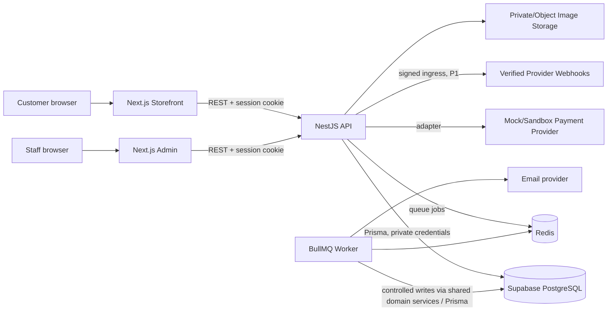
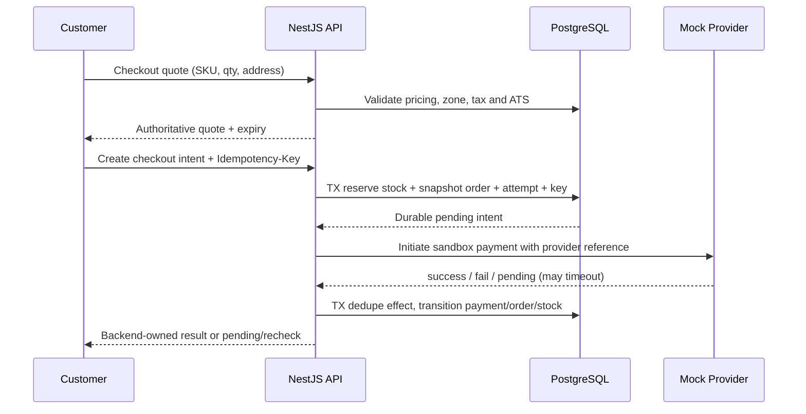

# CommerceHub — System Architecture

**Document ID:** CH-BMAD-04  
**Filename:** `04-architecture.md`  
**Version:** 1.0 — architecture baseline candidate  
**Date:** 2026-10-18  
**Status:** APPROVED ARCHITECTURE BASELINE — 2026-10-18; financial, security, inventory and operational implementation gates remain open; no code authorized  
**Inputs:** `01-project-brief.md` v1.0 (scope baseline); `02-prd.md` v1.0 (approved 2026-10-18 with gates); `03-ux-specification.md` v1.0 (approved 2026-10-18)  
**Market:** Egypt-first, EGP, one merchant, physical products, multiple categories  
**Priorities:** P0 = MVP; P1 = V1; P2 = Future

> **Decision convention:** **ADOPT (architecture proposal)** means specified in this candidate and becomes binding only when architecture is approved. **GATED** means implementation of dependent financial/security capabilities must wait for named sign-off. **DEFER** means outside MVP. Provider selection, legal interpretations, tax treatment and current hosting capabilities are **not** asserted as verified. This document designs the system; it does not report code, environments or tests as completed.

---

## 1. Executive architectural summary

CommerceHub is a **modular monolith**: two isolated Next.js applications (customer storefront and staff admin), a single NestJS REST API that owns all business logic, a centralized PostgreSQL database hosted on Supabase, and an optional dedicated BullMQ worker using Redis. The API is the **sole application database writer and reader**; browser code and Next.js server routes must not connect to database, privileged Supabase service credentials or provider secrets. Shared packages contain *safe* types, validation contracts, presentational components and a typed API client; authoritative calculations and permission enforcement live only in NestJS.

A small single-merchant deployment can begin with an API process and PostgreSQL; Redis/worker infrastructure is introduced for durable expiry/retry and other jobs when those workflows are implemented. Reservation expiry correctness **cannot** depend on a worker always running: use expiring holds plus DB-checked state and periodic cleanup, with database transactions preserving invariants. External payment and email systems are treated as failure-prone boundaries, never included in an assumed cross-service transaction.

### 1.1 Design goals and measurable architectural properties

1. **Correctness:** zero oversold SKU units in controlled last-unit concurrent tests; no duplicate paid effects or duplicate orders from replayed checkout intents; invariant-backed financial snapshots.
2. **Security:** least-privilege staff rights enforced per API action and resource; hostile user IDs, CSRF attempts and forged client totals cannot bypass controls; revocation works for active sessions.
3. **Maintainability:** bounded modules, explicit contracts, migrations, ADRs and tests; no separate admin-specific business layer.
4. **Resilience:** idempotent retry paths, recoverable checkout, durable event receipt, stock cleanup and operator-visible exceptions.
5. **Performance:** no admin cross-page eager queries; bounded database access, server-side pagination and observable latency.
6. **Deployment readiness:** separate app origins, secure runtime configuration, backup/restore evidence and audited administrative operations.

### 1.2 Explicit non-goals for P0

No live payment provider, automated card handling, guest checkout, user-facing refunds/returns/cancellation, discounts/coupons, reviews/wishlists, multi-merchant, international taxes, multi-currency, live carrier APIs, data warehouse, event bus, Kubernetes or microservices. The **P0 foundations** for payment history, refund-safe schema expansion, audits, email verification and background processing may be included without exposing P1 workflows.

## 2. Logical architecture and trust boundaries



**Trust zones:** public web clients; independently secured storefront and admin application origins; API boundary; privileged private application runtime; PostgreSQL/Redis/object store; external providers. CORS is browser protection, **not** authorization. Server-rendered pages may call the shared API with request-scoped credential forwarding where appropriate; they must not import Prisma or query Supabase directly. A dedicated media delivery URL may serve public approved product assets, not private objects.

**Network/data rule:** only the NestJS API and its trusted worker services hold database credentials. Neither frontend deployment environment contains `DATABASE_URL`, Redis secrets, provider signing secrets or Supabase `service_role` keys. Supabase Auth and client-to-database Supabase access are **not** used; CommerceHub owns its session and RBAC implementation.

## 3. Repository topology and build boundaries

```text
commercehub/
├── apps/
│   ├── storefront/              # Next.js App Router: customers
│   │   ├── app/                  # public, auth, account, checkout routes
│   │   ├── features/             # page-owned features, queries and view logic
│   │   ├── components/
│   │   └── tests/
│   ├── admin/                   # separate Next.js App Router deployment
│   │   ├── app/                  # protected admin routes
│   │   ├── features/             # overview, catalog, inventory, orders, staff
│   │   ├── components/
│   │   └── tests/
│   └── api/                     # NestJS modular-monolith application
│       ├── src/
│       │   ├── modules/         # independent bounded domain modules
│       │   ├── common/          # request context, errors, pipes, guards
│       │   ├── infrastructure/  # Prisma, Redis, adapters, telemetry
│       │   └── main.ts
│       ├── prisma/              # schema/migrations (owned by backend)
│       └── test/                # unit/integration/e2e
├── packages/
│   ├── ui/                      # design tokens, accessible presentation only
│   ├── types/                   # wire DTO types, enums, public view models
│   ├── validation/              # safe public field schemas; not security authority
│   ├── api-client/              # typed REST client; no direct DB calls
│   └── config/                  # shared lint/TS/test config (optional)
├── docs/
│   ├── bmad/                    # seven approved source documents
│   ├── adr/                     # architecture decision records
│   ├── runbooks/                # operations, incidents, restore, rotation
│   └── api/                     # generated OpenAPI specs
├── infrastructure/
│   ├── docker/                  # local compose examples
│   ├── github/                  # CI workflows (or .github/workflows)
│   └── deployment/              # environment-specific configuration
├── .github/workflows/
├── AGENTS.md                    # repo-level Codex constraints, task protocol
├── package.json
├── pnpm-workspace.yaml
└── turbo.json                   # optional build orchestration
```

**ADOPT:** pnpm workspaces, strict TypeScript, locked dependency tree, isolated app builds and clearly versioned shared contracts. Turbo is optional; add only if the workspaces benefit. Each app owns route-level loading/error boundaries and route segments. Use explicit imports and enforce architecture with lint/import-boundary checks. Client bundles must not import `apps/api`, Prisma, payment internals or Node-only packages. No generated API client build should leak server DTO secrets or private admin data.

**Testing/build commands (planned, not executed):** `lint`, `typecheck`, `test`, `test:integration`, `test:e2e`, `build`, `db:migrate:deploy` with workspace equivalents; actual scripts to be finalized during task planning.

## 4. Runtime and module composition — NestJS

### 4.1 Layered request path

`HTTP Controller → authentication/session middleware → authorization guard + resource policy → DTO validation → application service → domain policy/transaction coordinator → repository (Prisma) / provider adapter → presenter/response DTO`.

- **Controllers:** transport/versioning, documented DTOs, status codes; no stock/pricing business rules.
- **Application services:** coordinate use cases, idempotency, transaction boundaries, events/outbox.
- **Domain policies:** pure functions/state transition rules (Money, Inventory, Orders, Permissions).
- **Repositories:** persistence constrained to module ownership; transaction handles explicit.
- **Infrastructure adapters:** Prisma, payment, mail, image storage, queues, telemetry.
- **Cross-cutting:** correlation ID, validation, security headers, response sanitization, error mapping, structured logging and request limits.

Avoid NestJS circular module references; prefer read models, internal interfaces or explicit orchestration services. One business operation should have one clear transaction owner, not stacked service methods each opening unrelated transactions. Dependency injection provides provider stubs in tests.

### 4.2 Module catalog and release ownership

| Module | P0 responsibility | P1 extension | Owned persistent aggregates |
|---|---|---|---|
| Identity | customer/staff login, registration, password recovery, email verification, sessions | session management UI | users, credentials, sessions, verification/reset tokens |
| Access Control | roles, permissions, staff lifecycle, super-admin invariants | reusable bundles, audit browsing | roles, permissions, assignments |
| Catalog | products, categories, brands, sellable variants, publish/archive, media metadata | richer merch tools | product, SKU, taxonomy, media metadata |
| Cart | authenticated durable cart, server-validated lines | wishlist | carts, cart items |
| Addresses | customer delivery addresses | saved preferences | addresses |
| Pricing / Checkout | authoritative quote, flat shipping, tax policy interface, idempotent checkout | coupons/promotions | quotes, order intent keys, price rule versions |
| Inventory | SKU on-hand/reserved/available, adjustments/movements, holds, expiry/consume/release | advanced alerts/holds | stock, reservation, movement |
| Orders | snapshots, status histories, basic fulfillment, unpaid void | cancellation, returns, tracking | orders, lines, statuses, shipments |
| Payments | mock/sandbox adapter, attempts and state reconciliation | selected provider, verified webhooks, reconciliation | intents, attempts, payments, provider events |
| Administration / Overview | scoped dashboard aggregates, basic settings | reports, customer service | scoped read models/settings |
| Audit | security-sensitive append-only audit writer | query/export UI | audit events |
| Notifications | P0 essential verification/reset via a trusted delivery adapter | customer event notifications | delivery attempts, templates |
| Returns / Refunds | *no user workflow*; protected interface seam only | approvals, full/partial refunds | returns, refund requests, refunds |
| Marketing / Reviews | not shipped | coupon/redemption, reviews | promotions, redemptions, reviews |

**Avoid creating every P1 table prematurely.** Database design should finalize what P0 requires and explicitly document P1 planned migrations. Read models can query multiple modules through approved query services; writes may never bypass owning domain invariants.

### 4.3 Domain event policy

For P0, in-process domain events are only advisory for noncritical side effects. An **outbox record written in the same PostgreSQL transaction** as critical committed transitions is the durable bridge to Redis jobs and notifications; outbox dispatch may be polling-based. Consumers must be idempotent, acknowledge only after durable effect, and tolerate duplicates/reordering. Never assume NestJS `EventEmitter` or Redis messages alone guarantee delivery. Use bounded retries, backoff, dead-letter reporting and outbox cleanup/retention policy.

## 5. API surface and contract governance

- Version REST routes under `/api/v1`; OpenAPI generated from NestJS DTOs and checked in CI for breaking changes.
- DTO parsing/validation: whitelisted input fields, strict Zod/shared validation where appropriate, Nest pipes, max lengths, pagination bounds, enum validation, safe sort/filter allowlists. Client validators are **UX helpers** only; backend validates again.
- Error envelope (proposal): `{ error: { code, message, details?, requestId } }`; production never returns stack traces, SQL/Prisma errors or raw provider payloads.
- Paginate list endpoints; cursor-based for growing ledgers/audit, offset/page optionally for admin operational tables where stable sorting is defined. Every list has deterministic tie-break sort.
- Request id on ingress and logs; `Idempotency-Key` required for critical checkout and later payment/refund execution.
- All protected resource endpoints recheck ownership/permissions, even when the frontend hides controls. Return 404 for cross-user resource lookup where existence would otherwise leak; 403 for permission denial as policy dictates.
- Bulk reads and writes are bound. No unbounded exports or N+1 query loops.
- Detailed endpoint schemas and response contracts belong to `06-api-design.md`; these conventions constrain it.

## 6. Identity, cookies, sessions and CSRF

### 6.1 Account boundaries

**ADOPT:** single identity store with users classified customer/staff eligibility, **separate session audiences** (`storefront`, `admin`) and authorization contexts. Being a registered customer does not grant admin access. Privileged staff membership/assignment is mandatory and rechecked server-side. Do not trust user-supplied role claims; do not embed effective permissions in long-lived client tokens.

**Credential lifecycle:** Argon2id password hashes with benchmarked per-environment parameters and explicit upgrade path; password policy and breached-password checks as feasible; generic login/recovery messages to avoid enumeration; throttling by identity/IP/risk; server-generated cryptographically secure random tokens, hash stored for verification/reset, TTL, single use; changes to password/inactive staff membership revoke applicable active sessions.

### 6.2 Opaque server sessions

**ADOPT (security gate):** opaque random session ID in `HttpOnly; Secure; SameSite=Lax` cookies in HTTPS environments; persist only a cryptographic hash/HMAC of the secret in DB, with user, audience, issued/expires/revoked timestamps, last-use and revocation version as relevant. Rotate session identifier on login or privilege elevation, bound idle and absolute lifetime, and recheck privileged access per request. Server session lookup may use Redis acceleration only if DB remains authority and revocation is effective immediately. Do not store auth tokens in `localStorage` or `sessionStorage`.

**Origin strategy:** deploy storefront and admin on separately controlled subdomains with API on a known origin (e.g. `shop.example.com`, `admin.example.com`, `api.example.com` as illustrative placeholders). Prefer host-only scoped cookies and an explicit **same-origin BFF/proxy path** per frontend (cookie termination and secure API forwarding) if this avoids third-party cookie problems; a single shared `Domain=.example.com` credential cookie is **not** the default. Final BFF vs API-origin cookie plumbing, logout routing, cookie prefixes (`__Host-` where compatible), cross-subdomain `SameSite` behavior and hosting domains require a proof-of-concept and security sign-off before auth coding. BFF may forward a signed/session credential to API but never independently decide privilege; API remains sole authorization authority. SSR responses must prevent cross-user caching.

### 6.3 CSRF and browser defense

For cookie-authenticated mutation endpoints: verify exact allowed `Origin` and/or `Referer` (with secure absent-header policy), require anti-CSRF token or double-submit strategy with cryptographic binding to session, protect unsafe HTTP methods including logout and role changes, and use `SameSite` as defense-in-depth rather than sole control. Tight CORS allowlist with credentials only for required origins; no wildcard `Access-Control-Allow-Origin`. CSP with nonce/hash where needed, security headers, HSTS in deployment, secure file upload controls, escaping/XSS prevention and no secrets in hydrated Next.js props.

### 6.4 Authorization matrix and governance

**ADOPT:** permission-based RBAC; roles are named collections but guards check effective permission **and** object policy. Example minimum permissions:

| Capability | Customer | Catalog admin | Inventory admin | Fulfillment admin | Super Admin |
|---|---|---|---|---|---|
| `catalog.read_public` | Published | Published/assigned | Published/assigned | Published/assigned | Yes |
| `catalog.write`, `catalog.publish` | No | As assigned | No | No | Yes |
| `inventory.read`, `inventory.adjust` | No | Not by default | Yes, scoped | Read if granted | Yes |
| `orders.read`, `orders.fulfill`, `orders.void_unpaid` | Own read only | No | No | Granted subset | Yes |
| `staff.invite`, `staff.disable`, `rbac.assign` | No | No | No | No | Yes |
| `audit.read`, `settings.manage` | No | No | No | No | Yes |

Every action is **deny-by-default**, privilege must be explicit, permissions are evaluated in API (not Next.js), and sensitive changes are audited. `Super Admin` invariant: never deactivate/remove/demote the **last active Super Admin**; guard against self-grant and escalating beyond grantor permission. Grant/change actions may require recent reauthentication or second approval for high-risk operations (security review); do not claim those controls are implemented until approved. Admin list/overview queries must be data-scoped as well as action-scoped. Customer ownership policy checks are separate from staff permission checks.

### 6.5 Account and admin abuse cases

Test brute force, credential stuffing/throttling, session fixation, stolen cookie/replay, expired/reset token reuse, IDOR on order/address/cart, tenant-like account crossover (despite single merchant), deactivated staff access, role-change race, CSRF on unsafe actions, mass assignment and stale permission caches. Avoid broad error strings that reveal whether an email is registered.

## 7. PostgreSQL, Prisma and data ownership

**ADOPT:** PostgreSQL at Supabase; Prisma migration-driven schema; `NUMERIC(p,s)` for monetary values and explicit ISO 4217 `EGP`; UTC timestamps plus domain-specific time zone interpretation when necessary. Money conversion and calculation use decimal-safe library in API, never binary JavaScript floating-point for price math. Integer minor-unit representation may be used inside selected application helpers if bounded, but PostgreSQL remains `NUMERIC` and persisted API prices use canonical decimal strings. Database constraints, uniqueness, foreign keys and transaction isolation are integrity controls, not optional tests.

### 7.1 Aggregate ownership and invariants

- **Identity:** unique normalized email according to approved case-folding policy; secret hashes, session revocations, assignment history.
- **Catalog:** stable SKU identifiers; published sellable variants have valid variant prices/currency and required metadata; archived products preserved for order history.
- **Inventory:** per-SKU `on_hand >= 0`, `reserved >= 0`, `reserved <= on_hand`; available-to-sell `ATS = on_hand - reserved`; reservations have owner/expiry/status; ledger records every adjustment/commit/release.
- **Orders:** historical product name/SKU/options/unit price, quantity, discounts, shipping/tax, address and currency snapshots immutable after acceptance; fulfillment and payment statuses distinct.
- **Payments:** idempotency scope and event identity unique; attempts immutable or append-only with explicit state changes; payment business effect applied once.
- **Audit:** append-only action, actor, target, before/after **redacted** metadata, request correlation and occurred time. Never store passwords, credentials, payment-card data or sensitive raw webhook bodies in audit.

### 7.2 Persistence and migration conventions

Use unique composite keys (cart per user, cart line per SKU, `(actor_scope, idempotency_key)`, provider event identity), check constraints, controlled status enums or reference rules, stable FK references, `NUMERIC` precision sized by financial sign-off, version columns for optimistic concurrency where useful, and indexes for catalog lookup, order history, staff queue, active expiring reservations, sessions and audit filters. Soft archive parent entities whose history must remain; do not physically cascade delete historical finance rows. Raw SQL is allowed only for carefully reviewed atomic updates/locks not well expressed by Prisma. Schema diagram, migration ordering, concrete names/precision and indexing proofs belong to `05-database-design.md`.

**Connections:** API through Supabase supported transaction/session pooler as appropriate for chosen hosting; apply Prisma connection guidance for pooling and migrations. No assumption that direct database endpoint supports IPv4. Pin supported client/version at implementation time, validate TLS, restrict grants, use a least-privilege application DB role and a separate migration role. No RLS-based browser data access; evaluate database role safety and optionally RLS as defense-in-depth, not as the primary auth layer. Migrations run once from a controlled CI/release step, **not** from each API replica at startup.

## 8. Authoritative pricing and financial policy

**P0 financial design is GATED for sign-off.** Proposed conceptual quote pipeline:

1. Load active SKU, canonical unit price and quantity; validate published state and current availability. Lock/reread inventory during order reservation.
2. Build order line extension and pre-discount merchandise subtotal using `Decimal` and explicit currency; never trust UI totals.
3. Apply only approved adjustments (P0: no coupon/promotion engines). Persist named rule versions for future compatibility.
4. Resolve supported Egyptian shipping zone and configured EGP flat fee from **server-owned** address and rules, not user price fields.
5. Apply configured tax rule and tax inclusion flag. **No fixed Egyptian tax rate or legal basis is assumed**; tax-inclusive amounts must not be added again; tax on shipping requires specific policy.
6. Allocate taxes/discounts/shipping using a deterministic algorithm, documented rounding stage and remainder policy so summed lines equal order totals. Proposed two-decimal half-away-from-zero rounding is **not finalized** until financial review.
7. Persist quote ID, line and aggregate snapshots, applied rule version, EGP, quote expiry, and quote fingerprint. Require re-confirmation when price, stock or delivery/tax rule changes.
8. Validate order intent against current authoritative quote (server timestamp, signed or DB-stored quote, expiry) before reserving and accepting payment.

**Constraints:** order value nonnegative; no overflow; no mixing currencies; historical snapshots cannot change after later product edits. All payment amounts compared against persisted order amount/currency, not browser request. Financial test fixtures must include `.005`, discounts allocation pennies, tax included/excluded, shipping taxable/non-taxable, zero subtotal, large allowed values, multi-item splits and refund limits (P1). **Live payment gate:** legal/tax/accounting review, provider settlement/tax requirements, charge/refund tests and ledger reconciliation before enabling real money.

## 9. Inventory concurrency and reservation lifecycle

### 9.1 Stock model and transaction design

**ADOPT conditional transactional locking:** reserve units by atomically checking `on_hand - reserved >= requested_qty` and incrementing `reserved` within the same database transaction that creates the reservation record and order intent. Use `SELECT ... FOR UPDATE` or conditional `UPDATE ... WHERE on_hand - reserved >= q RETURNING ...` and lock SKUs in a stable order for multiple variants; choose concrete SQL/Prisma pattern via database ADR and race tests. Do not rely on a prior unlocked ATS read. All mutations validate `on_hand >= reserved >= 0`, use bounded transactions, and retry serialization/deadlock errors with strict caps and jitter, not infinite loops.

**Commit once on successful payment:** when payment outcome is confirmed, transactionally change eligible reservation from ACTIVE to CONSUMED, decrement **both** `on_hand` and `reserved` once, record stock movement and advance order/payment state. No worker or duplicate callback may consume twice. For failed/voided/expired unpaid intents, ACTIVE → RELEASED or EXPIRED decreases `reserved` once but does **not** decrease `on_hand`. For inventory adjustment, prevent reducing on-hand below still-active reserved quantity. Returns/restock are P1 explicit operations, not automatic on refund.

**Proposed reservation TTL:** 15 minutes (PRD POL-11 / DEC-06), **GATED** final architecture + product acceptance. A hold is not equivalent to an unconditional guarantee of payment acceptance after expiry. Check both persisted state and effective expiry at commit; late-success payments are a reconciliation exception and trigger compensation/refund policy in P1 or a controlled manual sandbox resolution in P0, never silent oversell. Expiry worker compares state and time transactionally; lazy expiry checks on checkout/stock reads plus cleanup job ensure safe correctness if queues are down.

### 9.2 State machine (candidate)

`ACTIVE → CONSUMED | RELEASED | EXPIRED` terminal; reservation create is unique for `(checkout_intent, sku)`; terminal transition replays return existing result. Separate `Order.payment_state` from `Order.fulfillment_state`. The following are examples, subject to state machine approval:

- **Payment:** `UNPAID → PENDING → PAID | FAILED` with `PENDING → EXCEPTION` for uncertain/late events; no terminal PAID→FAILED rollback.
- **Fulfillment:** `UNFULFILLED → PROCESSING → SHIPPED → DELIVERED`; fulfillment requires PAID, and a valid authorized transition.
- **Order unpaid void:** permitted only when no captured payment; releases eligible holds exactly once. Customer cancellation P1.

Definitive allowed transitions, out-of-order provider effects and status code vocabulary will be specified in `06-api-design.md` with transition tables and tests.

### 9.3 Critical concurrency tests

Two customers buy the final unit simultaneously; retry checkout with same and conflicting idempotency payload; multi-SKU deadlock stress; adjusted stock during reservation; expired cleanup vs paid commit; timeout vs provider success; duplicate/out-of-order events; worker downtime/backfill; multiple worker deliveries. Expect conservation invariants and exactly-once *business effect* (not exactly-once network delivery).

## 10. Checkout, payment, idempotency and provider adapter

### 10.1 Checkout sequence (sandbox P0)



The API must not hold an open DB transaction over provider network calls. Persist intent and reservation **before** initiating external charge. When the provider request times out, state remains **PENDING/UNKNOWN**, and the client sees recheck—not a fabricated failure or second independent charge. Payment adapter supports create/initiate, retrieve/query, interpret authenticated event, and P1 refund methods, with standardized provider IDs/status mappings.

### 10.2 Request idempotency

Require unique `(actor or customer, endpoint operation, Idempotency-Key)` with canonical request-body hash, `IN_PROGRESS / SUCCEEDED / FAILED_RETRYABLE` status, response/result reference and TTL/retention policy (to be sized in DB/API design). Same key + same payload returns the first durable result; same key + different payload = conflict; concurrent same-key attempts serialize using row uniqueness/lock. A timed-out client receives the existing intent/order and may fetch current state, not create a second charge. Do not cache sensitive entire HTTP responses indiscriminately.

**Payments:** stable merchant operation key passed to provider if supported; provider payment/transaction ID unique; verify amount, currency and target order before applying success. The provider's 'success' string alone is insufficient without verifying trusted origin and canonical amount/status. For P0 mock, ensure deterministic injected delayed/failed/replayed outcomes.

### 10.3 Provider webhook ingress (P1 architecture seam)

`POST /api/v1/webhooks/payments/{provider}` must be publicly reachable **but not unauthenticated in trust terms**: authenticate provider request by its documented signature/HMAC/certificate or signed callback design, validate freshness/timestamp and body bytes in the required format, enforce payload size/rate protection, dedupe event ID + provider, persist event receipt durably, acknowledge promptly, process asynchronously with retry and order-independent reconciliation, alert on unrecognized/conflicting event. Never mark paid based on an unsigned browser redirect or forged webhook. Secrets support rotation. Some providers may not offer every capability; select only after evidence-based review.

### 10.4 P1 refund financial invariants

A separate refund intent has unique idempotency key and approval event. Require `sum(successfully_refunded + currently_reserved_for_refund) <= captured_amount` at payment/line allocation level; prevent double approvals/executions and concurrent over-refund using DB lock/conditional update. Refund provider result may be pending; never mark complete before authoritative confirmation. Preserve all attempts, reversals and audit trails. Inventory restock is a separate inspected merchandise decision, not an automatic refund side effect.

### 10.5 Egyptian gateway selection gate

**No real gateway is selected in this document.** Before any live integration, verify current eligibility for Egyptian merchants, required business registration, EGP settlement, supported cards/wallets, hosted/redirect UX, tokenization/PCI scope, sandbox credentials, asynchronous payment confirmation, webhook authentication, partial/full refunds, reconciliation exports, fees, chargebacks, downtime operations and payout cadence. Record sourced comparisons in a payment ADR; legal/compliance and product approval required. P0 uses built-in mock/sandbox only; no card collection.

## 11. Redis, BullMQ and durable background work

**ADOPT conceptual topology; phase deployment by need:** dedicated Redis (managed or container) for BullMQ; separate always-on worker runtime for expiring reservations, outbox delivery, verification/recovery email retries, and P1 reconciliation/notifications. **Vercel cron/serverless is not assumed to be an always-on worker.** In local development, Docker Compose may run API, PostgreSQL-compatible DB/connection and Redis/worker. Production NestJS API and workers require appropriate independently managed long-running hosts (provider selection gated on availability, cost, regions, security and operations).

Job categories: `reservation.expire`, `outbox.dispatch`, `email.send`, `payment.reconcile` (P1), `notification.dispatch` (P1). All jobs use stable logical IDs, idempotent consumers, retries with exponential backoff and jitter, maximum attempts, poison queue/failed-job visibility, retention, request correlation, and rate caps. Worker runs with restricted DB and provider credentials; worker operations call shared application/domain services, not ad-hoc SQL that bypasses stock invariants.

**Failure mode:** Redis loss/downtime stops asynchronous delivery but cannot corrupt committed order/stock state; periodic recoverer scans bounded expired holds / outbox rows after restart. Job completion does not replace transactional state checks. Capacity and retry deadlines defined in `07-implementation-plan.md`.

## 12. Object storage and media safety

Use a provider-neutral storage adapter with Supabase Storage or another object store as a **candidate**. Backoffice upload uses short-lived authenticated server-mediated or server-issued signed URLs, file type validation from bytes, size/dimension limits, optional malware scanning, image transcoding/optimization, canonical object keys, no executable content delivery, protected private originals, and public delivery of approved product media only. Asset URLs persisted as metadata, not arbitrary path claims from clients. Orphan cleanup is a scheduled job. Image quotas, provider and retention policy require operations approval.

## 13. Frontend architecture and fetch isolation

### 13.1 Storefront

Next.js App Router with public catalog routes, auth boundaries and authenticated account/checkout segments. Prefer server-rendered discoverable catalog/product metadata and SEO-friendly canonical URLs; client TanStack Query for personalized cart/session-aware interactive data, mutation invalidation and transactional pending views. Never expose internal session, private customer or finance data in static caching/SSR hydration. Checkout amounts are rendered directly from API quote and conflict states; one pending payment intent visible at a time.

### 13.2 Admin

Separate Next.js app/deployment/origin and staff-only session. Lightweight shell loads **session identity + permitted navigation metadata only**; it must not query products, orders, inventory, customers and payments on first mount. Active `/` overview requests **one scoped aggregation** (plus separate auth capability data if needed). Each route owns its query keys, filters, pagination, cache invalidation, loading/error and background refresh; no global route prefetch of large datasets. For inaccessible modules, do not fetch dataset and show denied state. Server-side search/sort/filter/pagination; charts only where active and aggregated at API, not giant raw payloads. Query cancellation on route changes, no uncontrolled polling/refetch loops.

### 13.3 Cross-frontend libraries

- **TanStack Query:** server state, dedupe, typed query keys, conservative refetch and scoped invalidation.
- **Zustand:** lightweight *client UI state*, filters/drawer/dialog preferences only where justified; not the authoritative store for orders, finances or privileges.
- **React Hook Form + Zod:** accessible client forms and inferred DTO helpers; validated again API-side.
- **Tailwind + shadcn/ui + Radix:** shared tokens/accessible primitives; feature modules own composites; avoid shipping privileged admin components to storefront.
- **Recharts:** admin aggregate charts only when their route is active; **Motion** for restrained animations with reduced-motion fallback.
- **SEO and performance:** optimized images, lazy media, metadata, stable product URLs, semantic markup, code splitting and measurable Core Web Vitals.

**UX contract:** compact admin controls approximately 36–40px where approved, correct alignment, responsive 360/768/1440 tests, no accidental page-level horizontal overflow, mobile cards or scoped table scroll, progressive disclosure, keyboard navigation, sensible skeleton/empty/error states and WCAG 2.2 AA target. Use design tokens defined by approved UX spec; no ad-hoc redesign during architecture implementation.

## 14. Deployment, configuration and environments

```text
Public Internet
  ├── storefront.example.com  -> Vercel Project A (Next.js)
  ├── admin.example.com       -> Vercel Project B (Next.js)
  └── api.example.com         -> managed long-running NestJS API
                                      ├── Supabase PostgreSQL (private credentials)
                                      ├── Redis (managed/private)
                                      └── Storage/provider adapters
                              managed worker -> Redis + restricted services
```

These are **illustrative domain names**, not reserved addresses. Hosting selection for API/worker remains an ADR, based on reliable background jobs, database connection limits, regional latency, pricing, logs, HTTPS and secrets. Vercel hosts frontends; do not assume a serverless Next.js route is suitable for persistent BullMQ processing. Supabase project, networks and available pooler mode must be verified at setup. Images may be served through CDN/object delivery with strict upload control.

| Environment | Purpose | Data and access rules |
|---|---|---|
| Local | Developer feedback, mock provider | synthetic data, local secrets not committed |
| CI | isolated tests and migration checks | ephemeral PostgreSQL/Redis fixtures; no production credentials |
| Staging | E2E/QA, security and restore rehearsal | synthetic data, sandbox providers, restricted admin |
| Production | public portfolio P0 MVP | no live charges unless independently authorized; seeded public demo content only |

**Config:** runtime environment schema validation; per-environment separate DB and API secrets, encryption at rest/in transit, centralized secret management, rotation plan, no secrets in frontend build env, no raw secrets in logs/CI artifacts. Feature flags gate P1 routes and live payment provider; disabling a flag must deny the API behavior, not just hide UI.

**Release sequence:** lint/type/test → migration review → staging deploy and smoke/E2E → explicit approval → backup/restore readiness → one controlled production migration → API/worker deploy → frontends → smoke monitoring and rollback plan. Database forward-compatibility expand/contract migration pattern; destructive data migrations require review and backup. Rollback must account for non-reversible database changes. Domain routing, cookie flow, CORS and webhook reachability tested using real target origins.

## 15. Observability, operations and recovery

- **Logs:** structured JSON, request/trace ID, actor pseudonymous ID, operation/result/latency and deployment version; redact credentials, cookies, address/email where unnecessary, payment data, secrets and raw webhook content.
- **Metrics:** API latency p50/p95/p99 by route and error rate; DB connection pool/load and lock contention; queue depth/age/dead letters; reservation ACTIVE/EXPIRED/CONSUMED counts; checkout attempts/failures; payment pending age; discrepancy/reconciliation exceptions; inventory invariant breaches (critical alert).
- **Tracing:** OpenTelemetry-compatible traces across HTTP → application service → Prisma/Redis/job correlation without capturing PII; instrument high-value checkout path.
- **Health:** liveness excludes transient external dependencies; readiness checks essential DB and optionally queue dependency according to criticality; `/health` returns minimal safe status; no secrets or internals.
- **Alerts:** unavailable API, high 5xx, backlog, failed mail verification, old pending payments, failed expiry sweeps, over-refund/inventory invariant check, Supabase storage/connection saturation.
- **Backups:** managed DB backups plus tested independent restore procedure and documented RPO/RTO **to be set before production**; distinguish provider snapshot claims from demonstrated restore. Back up durable object metadata and understand object storage retention. Never perform destructive migration on untested backup assumption.
- **Incident response:** isolate live payments via feature flag, preserve immutable evidence, reprocess outbox safely, reconcile stuck payment attempts, correct stock with audited compensating movement, rotate credentials, notify stakeholder and maintain incident log.

## 16. Security threat model (STRIDE-oriented)

| Threat / boundary | Abuse scenario | Architecture mitigation | Mandatory verification |
|---|---|---|---|
| Spoofing identity | credential stuffing/session theft | Argon2id, throttling, secure session cookie, rotation/revocation | login abuse, logout/expiry and fixation tests |
| Tampering cart/price | client submits cheaper amount or stock | server quote, whitelist DTOs, DB transactions | forged amount/qty tests |
| Repudiation | staff denies stock or permission change | immutable audit with request ID/actor | actor-target history tests |
| Disclosure | customer accesses another user's order | ownership checks, response minimization, 404 policy | IDOR matrix |
| Privilege escalation | admin grants self Super Admin | API deny-by-default RBAC, last-super-admin invariant | privilege-mutation tests |
| CSRF | cross-site POST via staff cookie | origin validation, CSRF token, SameSite | malicious-origin and token tests |
| Replay/double charge | same checkout or webhook resent | unique keys, body hash, event dedupe, conditional updates | replay/concurrency suites |
| Overselling | last unit reserved twice | atomic row locks/conditional update | multi-client stress test |
| Provider fraud | forged payment webhook/redirect | signature and raw-body verification, server reconciliation | invalid signature/replay tests |
| Upload compromise | SVG/script/polyglot/malware media | inspect content, restrict formats, isolate storage | malicious asset tests |
| Availability | expensive search, brute force, queue floods | rate and pagination limits, timeouts, job caps | load/DoS-bound tests |
| Supply chain/secrets | compromised dependency or leaked key | pinned lockfile, SCA, scoped CI secrets, rotation | dependency audit, secret scanning |
| Misconfiguration | permissive CORS/CSP or exposed DB | environment policy, least-privilege roles, IaC reviews | staging deployment tests |

**Privacy:** treat shipping addresses, emails, IP, order data and audit trails as personal data; collect minimally, authorize all reads, define purpose/retention/deletion/legal obligations before public user onboarding. Egypt-local legal/privacy/tax applicability requires specialist review; architecture alone is not legal assurance. Use no real payment-card data, CVV or magnetic stripe data.

## 17. Testing architecture and quality gates

| Level | Planned tooling | Required focus | Release gate |
|---|---|---|---|
| Pure unit | Vitest or Jest | Decimal operations, state machines, policies, permissions, schema validation | P0 |
| API integration | Jest + Supertest + disposable PostgreSQL | auth, ownership, DB constraints, transactional flows, idempotency | P0 |
| Concurrency | parallel HTTP/DB harness | last-SKU competition, retries, expiry/payment races | P0 |
| Frontend component | React Testing Library + Vitest/Jest | accessible forms, tables, status/error states, permission gates | P0 |
| Browser E2E | Playwright | shopper checkout sandbox, admin product→stock→fulfillment, staff permission denial | P0 |
| Contract | OpenAPI validation/client generation check | DTO compatibility, typed error and pagination | P0 |
| Security | targeted negative integration/E2E + SAST/SCA | CSRF, IDOR, forgery, sessions, secret leakage, upload boundaries | P0 |
| Visual/responsive | Playwright screenshots and a11y checks | 360/768/1440, compact admin, zero unexpected overflow, keyboard/zoom | P0 |
| Performance | reproducible load script and Web Vitals | route-focused fetching, checkout contention, bounded p95 | P0 candidate budgets |
| Operations | staging restore, fail/retry drills | worker down, stale payment, outbox replay, backup restore | Before production |
| Provider/refund | signed event and reconciliation scenarios | out-of-order webhooks, refunds, partial refunds, fee reconciliation | P1 / live gate |

**Evidence policy:** A task is complete only with recorded commands/results and observed behavior. Do not use unit mocks as sole evidence of DB concurrency or cross-origin cookie security. Exact coverage percentages, latency ceilings and accessibility baselines must be finalized in `07-implementation-plan.md` and demonstrated; PRD/UX targets are goals, not measured achievements.

**CI review order:** format/lint/typecheck → unit → disposable DB migrations + integration/security tests → build → E2E staging → manual financial/security sign-off. Test runner choice should be consistent across workspace; NestJS can use Jest while shared/frontend packages use Vitest if maintenance cost justified.

## 18. Architecture decision records (ADRs)

All entries are **proposed for approval**, not retrospectively approved. On approval, copy/update as individual `docs/adr/ADR-XXX-*.md` files, including alternatives, consequences, owner, date, and reversal conditions.

| ADR | Decision | Alternatives / rationale | Status / owner |
|---|---|---|---|
| ADR-001 | Modular monolith with one NestJS API | simpler consistency than premature microservices | Proposed / Architecture |
| ADR-002 | Two separate Next.js deployments | isolates staff UX/origin and customer bundles | Proposed / Frontend/Security |
| ADR-003 | PostgreSQL + Prisma + explicit SQL for locks | relational finance/inventory integrity | Proposed / Data |
| ADR-004 | Opaque, revocable cookie sessions with distinct audiences | revocation/audit stronger than unmanaged browser JWT | **Security gate** / Security |
| ADR-005 | API-enforced permission + ownership checks | UI guards alone insufficient | **Security gate** / Security |
| ADR-006 | Atomic inventory holds + 15-minute candidate expiry | oversell prevention; TTL remains product/security/operations review | **Reservation gate** / Backend/Product |
| ADR-007 | Decimal quote + financial rule versioning | avoid floats, preserve snapshots | **Financial gate** / Finance/Backend |
| ADR-008 | Request + provider idempotency, durable event inbox/outbox | duplicate and external-timeout resilience | **Payment gate** / Backend |
| ADR-009 | Mock/sandbox adapter first; Egypt provider unselected | avoids unsupported gateway and premature live charges | Live provider **DEFER** / Product/Finance |
| ADR-010 | Redis/BullMQ workers for async; DB remains truth | durable recovery across worker outages | Proposed / Operations |
| ADR-011 | Vercel frontends + separate persistent API/worker | serverless jobs unsuitable as always-on workers | Hosting choice open / DevOps |
| ADR-012 | Bounded TanStack Query per active page, Zustand UI only | avoids waterfall/eager requests | Proposed / Frontend |
| ADR-013 | No browser Supabase DB credentials | single backend trust authority | Proposed / Security |
| ADR-014 | Outbox to bridge DB and async side effects | avoid lost events after commit | Proposed / Backend |
| ADR-015 | Provider-neutral object storage adapter | separate upload authorization and delivery | Storage provider open / Operations |

## 19. PRD architecture and financial gate disposition

**Decision taxonomy:** `RESOLVED — PROPOSED` = concrete recommended design but requires owner approval of this architecture; `GATED` = further specialized financial/security/legal sign-off or proof; `DEFERRED` = not applicable P0. Approval of PRD/UX is **not** equivalent to approval of these unresolved items.

| PRD / policy gate | Disposition and exact dependency | Owner and next action |
|---|---|---|
| DEC-01 / POL-02 customer account for checkout | **RESOLVED — PROPOSED:** login required, no guest checkout P0 | Product: accept architecture behavior |
| DEC-02 / POL-04 email verification | **RESOLVED — PROPOSED:** verified before first checkout; links single-use | Product + Security: approve token/session lifecycle |
| DEC-03 cart merge | **RESOLVED — PROPOSED:** no persistent guest cart in P0; browser temporary cart may carry SKUs on login and must server revalidate; no automatic silent overwrite | Product: approve conflict UX in API design |
| DEC-04 shipping zones/fees | **GATED FINANCIAL/OPERATIONS:** Egypt-first supported destinations and configured flat EGP fee; addresses outside zones blocked | Product/Finance: define exact zones, shipping fee and taxability before checkout implementation |
| DEC-05 / POL-07 decimal rounding | **GATED FINANCIAL:** decimal strings/NUMERIC established; proposal half away from zero, 2 decimals; allocation remainder policy open | Finance + Backend: sign and fixture exact steps before pricing code |
| POL-08 tax policy | **GATED LEGAL/FINANCIAL:** configurable inclusive/exclusive rule and version; no fixed statutory rate, no silent zero | Finance/Legal: tax treatment, invoicing and rule configuration approval |
| DEC-06 / POL-11 15-minute hold | **RESOLVED — PROPOSED, GATED:** 15-minute candidate, database checks and sweeper; late success exception | Product + Backend: TTL, late-success compensation and stress-test sign-off |
| DEC-07 statuses | **RESOLVED — PROPOSED:** separate payment, reservation and fulfillment machines | Backend/Product: finalize exact transitions in API design |
| DEC-08 payment idempotency/expiry | **RESOLVED — PROPOSED, GATED:** stable operation key, body hash, provider dedupe and pending reconciliation; retention TBD | Backend/Finance: accept replay and timeout rules |
| DEC-09 cancellation cutoff | **DEFERRED:** customer-initiated cancellation P1; P0 admin unpaid void only | Product: specify P1 later |
| DEC-10 return/refund | **DEFERRED workflow P1; invariant predesigned:** captured amount bound, separated restock, approval/execution | Product/Finance: P1 refund eligibility and approval thresholds |
| DEC-11 permissions | **RESOLVED — PROPOSED, SECURITY GATE:** permission matrix and object policy, last Super Admin guard | Security + Product: sign granular matrix and step-up requirements |
| DEC-12 session/CSRF | **GATED SECURITY/DEPLOYMENT:** opaque cookie sessions, Origin + token defenses, BFF/proxy cross-origin proof | Security + Frontend: approve cookie transport and staging PoC |
| DEC-13 media | **RESOLVED — PROPOSED:** signed uploads, metadata and constrained public assets | Operations: storage/vendor selection |
| DEC-14 API/hosting/worker | **RESOLVED — PROPOSED:** NestJS private API, DB truth, long-running worker separate from Vercel | DevOps: validate host/network/pooler |
| DEC-15 observability/backups | **GATED OPERATIONS:** logging/metrics/backups designed; numeric recovery targets unset | Ops: define RTO/RPO and perform restore exercise |
| DEC-16 Egyptian live gateway | **DEFERRED TO P1 LIVE GATE:** no provider selected, sandbox only | Product/Finance/Security: source-backed eligibility + contract evaluation |
| Cross-cutting legal/privacy | **GATED BEFORE PUBLIC REAL-CUSTOMER LAUNCH:** data policies and Egyptian compliance review | Product/Legal: retention, notices and applicable obligations |

**Implementation authorization:** Architecture sign-off can approve module structure independently, but dependent checkout/tax/stock/session implementation tasks cannot start until their named gates are met. DB design and API design may proceed with marked assumptions, without claiming unresolved financial rules are final.

## 20. Risks, trade-offs and mitigation owners

| Risk | Severity | Mitigation | Owner |
|---|---|---|---|
| Pricing rounding/tax law misunderstood | Critical | finance/legal fixtures and signed rule versions before implementation | Finance/Product |
| Oversold inventory on concurrent checkout | Critical | locked conditional updates, reservation ledger, race suites | Backend/Data |
| Duplicate charge / inconsistent callback | Critical | stable idempotency, inbox/outbox, reconciliation, no client success | Backend/Payments |
| Session cookies fail across separate deployments | High | same-origin BFF/proxy PoC and precise CSRF/CORS configuration | Security/Frontend |
| Worker outage leaves reservations stale | High | DB effective expiry check, bounded sweeps, queued retry recovery | Backend/Ops |
| Production DB connection exhaustion | High | verify Supabase pooler strategy/connection budget, load tests | DevOps/Data |
| Admin RBAC privilege escape | Critical | least privilege, object policy, last Super Admin lock, negative tests | Security |
| UI overflow and excessive admin queries | High | UX tokens, component visual tests, route-owned query contracts | Frontend |
| Payment provider unsupported in Egypt | High (P1) | mock MVP; eligibility research and separate live gate | Product/Finance |
| Secrets/PII in logs | High | schema-aware redaction, logging policy and scanning | Security/Ops |
| Scope creep before MVP | High | strict P0/P1/P2 boundaries, change review and task IDs | Product/PM |
| Database migration irreversible | High | additive migrations, backup+restore rehearsal, explicit rollback | Data/Ops |

## 21. Handoff contracts for remaining BMAD documents

### `05-database-design.md` must specify

Complete P0 normalized entities, FK cardinalities, constraints/partial unique indexes, currency/NUMERIC precision, snapshot immutability, idempotency key storage, reservation transaction isolation/locking SQL, schema for inbox/outbox/audit, data retention, P1 migration seams, table-level permission grants and seed policy. Include ER diagram and executable transaction/concurrency acceptance cases. Financial gates remain flagged where relevant.

### `06-api-design.md` must specify

Complete P0 resource paths, request/response DTOs, HTTP status/errors, documented authentication cookie/CSRF semantics, per-endpoint permissions + object policies, pagination/filter enums, checkout quote and payment state flows, `Idempotency-Key` contracts, key conflict behavior, webhook P1 contract seam, OpenAPI and versioning. Cross-origin cookie PoC is required before locking final transport.

### `07-implementation-plan.md` must specify

Small dependency-ordered tasks with IDs, scope/owner, PRD and UX traceability, exact files/modules, required skills from `skills.sh` **verified before recommending install**, Codex prompt templates, acceptance scenarios, real automated tests, security and finance approval blockers, evidence/logs and no-claim-of-completion discipline. **No app code, schema migration, credentials, deployments or test execution is asserted here.**

## 22. Architecture review checklist and approval record

- [ ] Product owner confirms P0-only release scope, single merchant/EGP/physical goods.
- [ ] Architecture owner approves module boundaries, API-only DB access and ADR-001/002/003/013.
- [ ] Security owner approves privileged RBAC matrix, sessions and CSRF transport PoC (ADR-004/005).
- [ ] Backend/data owner approves reservation transaction proof and 15-minute TTL (ADR-006).
- [ ] Product/finance approves quote allocation, shipping zones, tax behavior and rounding fixtures (ADR-007).
- [ ] Payments owner approves sandbox attempt transitions, replay/timeout behavior (ADR-008/009).
- [ ] DevOps approves API/worker infrastructure candidate, DB pooler, secrets and backup/restore plan (ADR-010/011/014/015).
- [ ] UX owner confirms active-route data fetching, admin density, accessibility and responsive gates.
- [ ] DB and API design handoff includes all unsettled assumptions and explicit blockers.
- [ ] No implementation starts until relevant decisions and small tasks are approved.

**Product owner approval:** Approved architecture baseline 2026-10-18; specialist implementation gates remain open.  
**Architecture approval:** Approved as system-design baseline by Product Owner 2026-10-18; individual security, financial, inventory and operations sign-offs pending.  
**Financial approval:** Pending — checkout pricing/tax/shipping/rounding, TTL/late success policies.  
**Security approval:** Pending — cookie transport, CSRF, detailed RBAC.  
**Live payment approval:** Not sought; deferred beyond sandbox MVP.  
**Next BMAD step:** `05-database-design.md` drafted for review; specialist gate decisions remain open.
