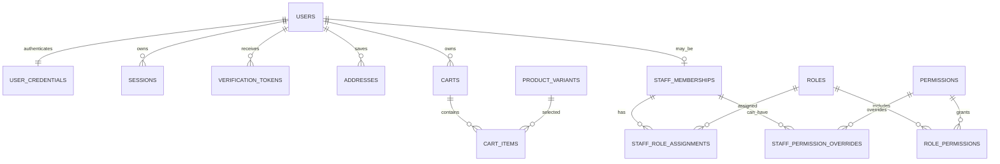
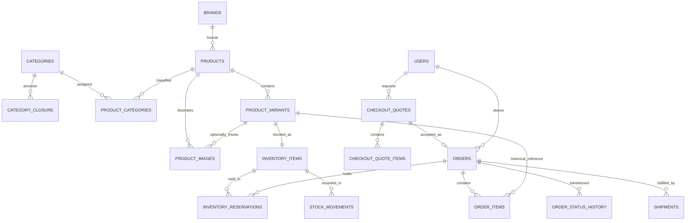
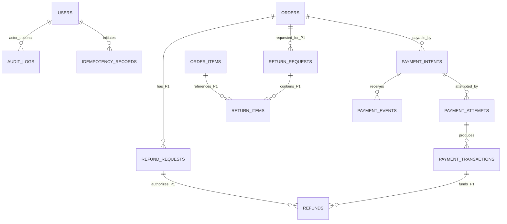

# CommerceHub — Database Design Specification

**Document ID:** CH-BMAD-05  
**Filename:** `05-database-design.md`  
**Version:** 1.0 — schema design candidate  
**Date:** 2026-10-18  
**Status:** APPROVED DATABASE DESIGN BASELINE — 2026-10-18; FIN-01, INV-01, SEC-01, PAY-01, FIN-02, OPS-01, LEG-01, PAY-LIVE and DB implementation review gates remain open; no migrations or code executed  
**Baseline:** `01-project-brief.md` approved; `02-prd.md` approved; `03-ux-specification.md` approved; `04-architecture.md` architecture baseline approved 2026-10-18, with financial/security/inventory/operations gates still open.  
**Scope:** Single merchant; Egypt-first, EGP checkout, physical multi-category products. P0 MVP plus P1 extensibility.  
**Owners for review:** Product, Backend/Data, Security, Finance, Operations.

> **Design status language.** **BASELINE** means derived from approved scope/architecture. **PROPOSED** is a concrete database modeling recommendation requiring data-design approval. **GATED** depends on a specialist policy/proof before affected implementation. **P1** and **P2** identify deferred workflows, not current implementation. SQL/Prisma fragments in this document are *illustrative specifications*, not migration files or executed statements. No schema is deployed by this document.

---

## 1. Purpose, goals, acceptance boundary

Design a normalized PostgreSQL source of truth used exclusively by the NestJS API and trusted workers. The schema must support persistent customer accounts, highly configurable category/brand/variant catalog, server-priced checkout, race-safe inventory, historically faithful orders, sandbox payments, staff RBAC, and append-only audit history. It must leave safe, deliberately scoped seams for P1 real-payment reconciliation, returns/refunds, coupons, ratings, and operational reporting.

**Non-negotiable database invariants:**

1. Browser and Next.js applications have **no database credentials**; direct Supabase browser reads/writes are forbidden.
2. Financial values are exact decimal (`NUMERIC`) and labeled with ISO currency; no floating-point financial storage.
3. `inventory_items.on_hand >= inventory_items.reserved >= 0` after *every committed transaction*; stock is never reserved via a read-then-write race.
4. A paid effect, reserve/consume/release effect, provider event, and refund effect is applied at most once despite duplicated requests and callbacks.
5. Order line/address/price/tax/shipping snapshots survive catalog edits, archive, shipping-rule changes, and account edits.
6. Authorization is evaluated in NestJS on each sensitive request; database constraints reinforce it, not replace it.
7. No cascade deletion of historical payments, orders, stock ledgers, refunds, or audits.
8. A database failure, queue outage, or provider timeout must leave a recoverable, inspectable state.

**Release split:** P0 tables are necessary for a sandbox purchase and admin workflows; P1 tables/specifications are *designed here but not automatically created in MVP migrations*. P2 entities (multi-merchant, warehouse networks, loyalty, regional settlement) are deliberately excluded.

## 2. Modeling conventions and domain ownership

| Convention | Design decision |
|---|---|
| Database | Supabase-managed PostgreSQL, schema `public` or a dedicated application schema selected by deployment; all business ownership stays in NestJS |
| Primary keys | UUID generated server/DB-side; do not expose sequential IDs as authorization proof |
| Time | `TIMESTAMPTZ` (UTC instants); a zone name or local date is stored separately when business rules need it; never infer Cairo calendar dates from UTC blindly |
| Names | `snake_case` plural tables, singular column attributes; FK suffix `_id`; timestamps `created_at`, `updated_at`; archive `archived_at` |
| Currency | `CHAR(3)`/`VARCHAR(3)` canonical uppercase ISO code; P0 allowed `EGP` enforced by service and constraints for payment/order/price records |
| Amounts | **Proposed** `NUMERIC(19,4)` internal component amounts and `NUMERIC(19,2)` settled/display snapshots; exact final scales and rounding stages **GATED FIN-01** |
| Quantities | `INTEGER` and `CHECK >= 0` for stock; cart/order/reservation line quantities `CHECK > 0`; maximum per line is application-configured |
| IDs/references | Stable UUID internal ID; globally unique canonical `sku`, human-readable order number from a dedicated allocator if required; no private facts embedded in public IDs |
| Enums | Candidate PostgreSQL enums or `VARCHAR` + `CHECK`; examples below use readable state strings; final enum/transition rules coordinated with `06-api-design.md` |
| Actor/context | `created_by_user_id` or actor snapshots on privileged actions; controlled `actor_type` for system jobs; never trust actor IDs from request bodies |
| Versioning | `version INTEGER NOT NULL DEFAULT 1` on mutable aggregates where optimistic concurrency is useful; increment atomically |
| JSONB | Only bounded *optional* variant attribute maps, sanitized snapshots, metadata, provider references; no JSONB substitute for relational amounts, permissions, or stock |
| Deletion | Archive/deactivate customers, staff, products, SKUs; limited hard deletes only for unreferenced disposable drafts; finance/history `RESTRICT` |
| Retention | Policy-driven, jurisdiction reviewed; technical retention examples are **not** claimed legal requirements |
| RLS | Not a browser-access mechanism. Least-privilege SQL roles and API authorization required; optional RLS defense in depth requires independent test |

**Boundaries:** Identity (users, credentials, verification, sessions, staff); Catalog (categories, brands, products, options/variants/images); Shopping (addresses, carts, quotes); Inventory (stock, holds, ledger); Orders (orders, lines, fulfillment, status history); Payments (payment intents/attempts/effects/webhooks/idempotency); Administration (roles, permissions, audit); P1 (returns/refunds, marketing/reviews/notifications). Foreign keys may cross module boundaries, but service-to-service invariants must be coordinated by one NestJS transaction coordinator.

## 3. Entity-relationship diagrams

### 3.1 Identity, RBAC, shopping



### 3.2 Catalog, stock and orders



### 3.3 Payment and P1 extensions



**Interpretation:** ER cardinality shows intended relationships, not every partial unique constraint or transition rule. Payment events can arrive without a local attempt match; their event identity is retained for investigation. Return/refund entities are designed for P1, not mandatory P0 migration objects.

## 4. P0 identity and authentication schema

Shared conventions: unless overridden, PK `id UUID NOT NULL`, `created_at TIMESTAMPTZ NOT NULL DEFAULT now()`, `updated_at TIMESTAMPTZ NOT NULL DEFAULT now()` where mutable. Timestamp updates are performed by services or controlled database trigger, never assumed automatic in PostgreSQL.

### 4.1 `users` — customer and staff identity

| Column | Type | Constraint / purpose |
|---|---|---|
| `id` | UUID | PK |
| `email` | `VARCHAR(320)` | NOT NULL, original display-normalized address |
| `email_normalized` | `VARCHAR(320)` | NOT NULL, unique using approved normalization rule |
| `email_verified_at` | TIMESTAMPTZ | nullable, checkout eligibility |
| `display_name` | `VARCHAR(160)` | NOT NULL |
| `phone_e164` | `VARCHAR(20)` | nullable, controlled optional uniqueness if required |
| `status` | `VARCHAR(20)` | NOT NULL CHECK IN (`ACTIVE`,`SUSPENDED`,`DEACTIVATED`) |
| `created_at`, `updated_at` | TIMESTAMPTZ | NOT NULL |
| `deactivated_at` | TIMESTAMPTZ | nullable, avoid historical FK deletion |
| `version` | INTEGER | NOT NULL CHECK >= 1 |

`UNIQUE(email_normalized)`; decide Unicode/local-part case-folding and whether PostgreSQL `citext` is appropriate at **SEC-01**; normalization changes require migration safety. Staff eligibility is **not** granted by a boolean claim on user or by customer registration.

### 4.2 `user_credentials`

| Column | Type | Constraint / purpose |
|---|---|---|
| `user_id` | UUID | PK + FK `users(id)` ON DELETE RESTRICT |
| `password_hash` | TEXT | NOT NULL; Argon2id PHC-format secret hash |
| `password_changed_at` | TIMESTAMPTZ | NOT NULL |
| `password_version` | INTEGER | NOT NULL >= 1 |
| `must_change_password` | BOOLEAN | NOT NULL DEFAULT false |
| `updated_at` | TIMESTAMPTZ | NOT NULL |

No raw passwords or pepper in DB; a pepper, if adopted, stays in protected secret management.

### 4.3 `sessions`

`id UUID PK`, `user_id UUID NOT NULL FK users RESTRICT`, `audience VARCHAR(16) NOT NULL CHECK IN ('STOREFRONT','ADMIN')`, `secret_digest BYTEA NOT NULL UNIQUE`, `created_at`, `last_seen_at`, `idle_expires_at`, `absolute_expires_at`, `revoked_at`, `revocation_reason VARCHAR(64)`, `ip_hash BYTEA NULL`, `user_agent_summary VARCHAR(240) NULL`, `credential_version_at_issue INTEGER NOT NULL`. CHECK `idle_expires_at <= absolute_expires_at`, and both >= creation. Index `(user_id, audience, revoked_at)` and active expiry index (see §13). Store only a one-way digest/HMAC of a high-entropy opaque cookie secret, never the actual session token. Admin membership and permissions rechecked on every request; a valid customer session never becomes an admin session.

### 4.4 `verification_tokens`

`id UUID PK`, `user_id UUID FK users RESTRICT`, `purpose VARCHAR(24) CHECK IN ('EMAIL_VERIFY','PASSWORD_RESET','STAFF_INVITE')`, `token_digest BYTEA UNIQUE NOT NULL`, `expires_at TIMESTAMPTZ NOT NULL`, `consumed_at TIMESTAMPTZ NULL`, `created_at`, `issued_context JSONB NOT NULL DEFAULT '{}'` (redacted). At use: single atomic update `consumed_at IS NULL AND expires_at > now() RETURNING ...` then apply account mutation in same DB transaction. Recovery does not reveal account existence. Restrict token validity and retention to approved security policy.

### 4.5 `addresses`

`id UUID PK`, `user_id UUID FK users RESTRICT`, `recipient_name VARCHAR(160) NOT NULL`, `phone_e164 VARCHAR(20) NOT NULL`, `line1 VARCHAR(240) NOT NULL`, `line2 VARCHAR(240)`, `district VARCHAR(120)`, `city VARCHAR(120) NOT NULL`, `governorate VARCHAR(120) NOT NULL`, `country_code CHAR(2) NOT NULL DEFAULT 'EG'`, `postal_code VARCHAR(24)`, `delivery_instructions VARCHAR(500)`, `is_default BOOLEAN NOT NULL DEFAULT false`, `archived_at TIMESTAMPTZ`, `created_at`, `updated_at`. Partial unique `(user_id) WHERE is_default AND archived_at IS NULL`; ensure default switch is transactionally serialized, so exactly zero or one default is allowed (not necessarily one). Orders carry **separate immutable address snapshot**, not a live address dependency.

## 5. P0 staff authorization and audit schema

### 5.1 Authorization tables

| Table | Columns and constraints |
|---|---|
| `staff_memberships` | `id UUID PK`, `user_id UUID UNIQUE FK users RESTRICT`, `status` (`INVITED`,`ACTIVE`,`SUSPENDED`,`REMOVED`), `is_super_admin BOOLEAN NOT NULL DEFAULT false` (**PROPOSED** protected classification), `invited_by_user_id UUID NULL FK users`, `activated_at`, `deactivated_at`, `created_at`, `updated_at`, `version INTEGER >=1` |
| `roles` | `id UUID PK`, `key VARCHAR(80) UNIQUE NOT NULL`, `name VARCHAR(120) NOT NULL`, `description TEXT`, `is_system BOOLEAN NOT NULL DEFAULT false`, `archived_at`, timestamps |
| `permissions` | `id UUID PK`, `key VARCHAR(120) UNIQUE NOT NULL`, `resource VARCHAR(64) NOT NULL`, `action VARCHAR(64) NOT NULL`, `description TEXT`, UNIQUE `(resource,action)` |
| `role_permissions` | `role_id UUID FK roles RESTRICT`, `permission_id UUID FK permissions RESTRICT`, composite PK; grants only, no implicit wildcard |
| `staff_role_assignments` | `id UUID PK`, `staff_membership_id UUID FK staff_memberships RESTRICT`, `role_id UUID FK roles RESTRICT`, `assigned_by_user_id UUID FK users RESTRICT`, `assigned_at`, `revoked_at`; unique active role assignment partial index `(staff_membership_id,role_id) WHERE revoked_at IS NULL` |
| `staff_permission_overrides` | `id UUID PK`, `staff_membership_id UUID FK`, `permission_id UUID FK`, `effect` CHECK IN (`ALLOW`,`DENY`), `reason VARCHAR(240)`, `granted_by_user_id UUID FK users`, `created_at`, `revoked_at`; UNIQUE active `(staff_membership_id,permission_id) WHERE revoked_at IS NULL`; deny precedence |

**Effective authorization:** user active + staff membership ACTIVE + an **ADMIN-audience** session + server resource policy + permission result. Super Admin is an elevated **server-governed** membership classification, not arbitrary customer self-service or a client-supplied permission. Staff without grants has no operating privileges. A SQL unique index cannot alone enforce “never remove/demote the final active Super Admin”: lock a singleton governance row or advisory lock and count active Super Admins **inside one transaction** before removal/demotion; reject when last would be lost. Direct SQL writes must be limited to trusted paths. All grants/revocations create audit entries in the same transaction, and invalidate server-side permission caches.

### 5.2 `audit_logs` (append-only)

`id UUID PK`, `occurred_at TIMESTAMPTZ NOT NULL DEFAULT now()`, `actor_user_id UUID NULL FK users RESTRICT`, `actor_kind VARCHAR(16) CHECK IN ('USER','SYSTEM','PROVIDER')`, `actor_membership_id UUID NULL FK staff_memberships RESTRICT`, `action VARCHAR(120) NOT NULL`, `target_type VARCHAR(80) NOT NULL`, `target_id UUID NULL`, `request_id VARCHAR(100)`, `correlation_id VARCHAR(100)`, `ip_hash BYTEA NULL`, `before_redacted JSONB NULL`, `after_redacted JSONB NULL`, `metadata_redacted JSONB NOT NULL DEFAULT '{}'`, `outcome VARCHAR(16) CHECK IN ('SUCCESS','DENIED','FAILURE')`. Index `(occurred_at DESC,id DESC)`, `(actor_user_id,occurred_at DESC)`, `(target_type,target_id,occurred_at DESC)`. No raw cookies, reset links, tokens, card data, full payment webhook payload, or unnecessarily sensitive address/PII. Revoke UPDATE/DELETE on audit tables for the runtime DB role where practical; insert through a controlled API path. Database superusers can still bypass app protections, so backups, DB access logs and operational restrictions matter. Audit is **not** a substitute for financial ledgers.

## 6. P0 catalog model (multi-category and variants)

### 6.1 `categories`, `category_closure`, `brands`

- `categories`: `id UUID PK`, `parent_id UUID NULL FK categories RESTRICT`, `slug VARCHAR(150) UNIQUE NOT NULL`, `name VARCHAR(160) NOT NULL`, `description TEXT`, `sort_order INTEGER DEFAULT 0`, `status` (`ACTIVE`,`HIDDEN`,`ARCHIVED`), `created_at`, `updated_at`, `archived_at`. Do not permit parent cycles; maintain a closure table or enforce guarded recursive validation in transactional category mutation.
- `category_closure`: `ancestor_id UUID FK categories RESTRICT`, `descendant_id UUID FK categories RESTRICT`, `depth INTEGER NOT NULL CHECK >=0`, composite PK; closure consistency is maintained by service operations, with tests for cycles and subtree moves.
- `brands`: `id UUID PK`, `slug VARCHAR(150) UNIQUE NOT NULL`, `name VARCHAR(160) NOT NULL`, `description`, `logo_asset_id UUID NULL` (FK to media after creation), `status` (`ACTIVE`,`ARCHIVED`), timestamps.
- `product_categories`: `product_id UUID FK products RESTRICT`, `category_id UUID FK categories RESTRICT`, `is_primary BOOLEAN DEFAULT false`, composite PK; partial unique `(product_id) WHERE is_primary`. Primary category may change without affecting historical order lines.

### 6.2 `products`

`id UUID PK`, `brand_id UUID NULL FK brands RESTRICT`, `slug VARCHAR(200) UNIQUE NOT NULL`, `name VARCHAR(240) NOT NULL`, `short_description VARCHAR(500)`, `description TEXT`, `status VARCHAR(20) CHECK IN ('DRAFT','ACTIVE','ARCHIVED')`, `published_at TIMESTAMPTZ NULL`, `archived_at TIMESTAMPTZ NULL`, `seo_title VARCHAR(240)`, `seo_description VARCHAR(500)`, `created_by_user_id UUID FK users RESTRICT`, timestamps, `version INTEGER >=1`. Store only content and product-level metadata here; prices and stock live at SKU/variant granularity. A draft is not purchasable; variants of archived products are not sellable.

### 6.3 `product_variants`, `variant_attributes`, `variant_attribute_values`

`product_variants`: `id UUID PK`, `product_id UUID NOT NULL FK products RESTRICT`, `sku VARCHAR(80) UNIQUE NOT NULL`, `barcode VARCHAR(120) NULL UNIQUE`, `title VARCHAR(200) NOT NULL`, `attributes JSONB NOT NULL DEFAULT '{}'` **(bounded display snapshot, not lookup authority)**, `status VARCHAR(20) CHECK IN ('DRAFT','ACTIVE','ARCHIVED')`, `unit_price NUMERIC(19,4) NOT NULL CHECK >=0` **GATED scale**, `compare_at_price NUMERIC(19,4) NULL CHECK >=0`, `currency CHAR(3) NOT NULL DEFAULT 'EGP' CHECK currency='EGP'` for P0, `weight_grams INTEGER NULL CHECK >=0`, `requires_shipping BOOLEAN NOT NULL DEFAULT true`, `archived_at`, `created_at`, `updated_at`, `version INTEGER >=1`. Every product, even non-configurable, has at least one variant. Validate sellable variant metadata in service before publication.

For user-selectable stable variant axes, use normalized P0 tables: `variant_attributes(id, product_id FK, key, label, sort_order, UNIQUE(product_id,key))`, `variant_attribute_values(id, attribute_id FK, value_key, display_label, sort_order, UNIQUE(attribute_id,value_key))`, and `variant_value_selections(variant_id FK, value_id FK, composite PK)`. Cross-product selection integrity and uniqueness of complete combinations are application validated under a product-scoped lock; optional canonical `combination_key VARCHAR(500)` with unique `(product_id, combination_key)` provides a DB-backed normalized-combination uniqueness invariant. The `attributes` JSONB is a snapshot derived from normalized selections for display/search, never the only uniqueness guard.

### 6.4 `media_assets`, `product_images`

`media_assets`: `id UUID PK`, `storage_provider VARCHAR(40) NOT NULL`, `object_key VARCHAR(500) UNIQUE NOT NULL`, `mime_type VARCHAR(100) NOT NULL`, `byte_size BIGINT NOT NULL CHECK >0`, `width INTEGER`, `height INTEGER`, `checksum_sha256 CHAR(64) NULL`, `scan_status VARCHAR(20) CHECK IN ('PENDING','CLEAN','REJECTED')`, `uploaded_by_user_id UUID FK users RESTRICT`, `created_at`, `deleted_at`. Store object identifiers, not publicly writable URLs or secrets.

`product_images`: `id UUID PK`, `product_id UUID FK products RESTRICT`, `variant_id UUID NULL FK product_variants RESTRICT`, `asset_id UUID FK media_assets RESTRICT`, `alt_text VARCHAR(240)`, `sort_order INTEGER DEFAULT 0`, `is_primary BOOLEAN DEFAULT false`, `created_at`. Enforce `variant.product_id = product_images.product_id` with a composite FK or service verification + trigger (choose migration-time proof), and unique primary `(product_id,variant_id)` with nullable handling explicitly designed; a partial unique index on product-only (`variant_id IS NULL`) plus variant-specific `(variant_id) WHERE is_primary` avoids PostgreSQL NULL uniqueness mistakes.

## 7. P0 cart and immutable checkout quote

### 7.1 `carts`, `cart_items`

`carts`: `id UUID PK`, `user_id UUID UNIQUE FK users RESTRICT`, `currency CHAR(3) CHECK ='EGP'`, `version INTEGER >=1`, timestamps. `cart_items`: `id UUID PK`, `cart_id UUID FK carts RESTRICT`, `variant_id UUID FK product_variants RESTRICT`, `quantity INTEGER NOT NULL CHECK >0`, timestamps, UNIQUE `(cart_id,variant_id)`. Cart is not authoritative for price or stock. Validate variant/stock/limits when creating a quote. P0 guest temporary cart (if offered) is browser-only; store merge revalidates every SKU and quantity after login.

### 7.2 `checkout_quotes`, `checkout_quote_items`

`checkout_quotes`: `id UUID PK`, `user_id UUID FK users RESTRICT`, `cart_id UUID FK carts RESTRICT`, `status` (`OPEN`,`ACCEPTED`,`EXPIRED`,`INVALIDATED`), `currency CHAR(3) CHECK ='EGP'`, `subtotal_amount NUMERIC(19,4)`, `discount_amount NUMERIC(19,4)`, `shipping_amount NUMERIC(19,4)`, `tax_amount NUMERIC(19,4)`, `grand_total_amount NUMERIC(19,4)`, `tax_included BOOLEAN NOT NULL`, `shipping_rule_version VARCHAR(80)`, `tax_rule_version VARCHAR(80)`, `pricing_rule_version VARCHAR(80)`, `address_snapshot JSONB NOT NULL`, `input_fingerprint CHAR(64) NOT NULL`, `expires_at TIMESTAMPTZ NOT NULL`, `accepted_at TIMESTAMPTZ`, `created_at`, `version INTEGER`. All amounts NOT NULL CHECK >=0; must satisfy the **approved** pricing identity when FIN-01 is finalized, taking tax-inclusive treatment into account; do **not** add inclusive tax again. Quote expiration duration is a distinct policy from reservation TTL.

`checkout_quote_items`: `id UUID PK`, `quote_id UUID FK checkout_quotes RESTRICT`, `variant_id UUID FK product_variants RESTRICT`, `sku_snapshot VARCHAR(80)`, `product_name_snapshot VARCHAR(240)`, `variant_title_snapshot VARCHAR(200)`, `options_snapshot JSONB NOT NULL DEFAULT '{}'`, `quantity INTEGER CHECK >0`, `unit_price_amount NUMERIC(19,4)`, `line_subtotal_amount NUMERIC(19,4)`, `line_discount_amount NUMERIC(19,4)`, `line_tax_amount NUMERIC(19,4)`, `line_total_amount NUMERIC(19,4)`, `currency CHAR(3) CHECK ='EGP'`, UNIQUE `(quote_id,variant_id)`. Require nonnegative amounts and finite width; the exact equality constraints must reflect FIN-01 signed calculation formula. On accepting a quote, copy into order snapshots in one transaction and prevent re-acceptance by unique order FK.

## 8. P0 orders, line snapshots, history and fulfillment

### 8.1 `orders`

| Column | Type | Constraint / purpose |
|---|---|---|
| `id` | UUID | PK |
| `order_number` | `VARCHAR(48)` | unique, public lookup identifier; never authorization factor |
| `user_id` | UUID | FK users RESTRICT; ownership enforced in API |
| `checkout_quote_id` | UUID | UNIQUE NOT NULL FK checkout_quotes RESTRICT (one accepted order per quote) |
| `currency` | CHAR(3) | NOT NULL CHECK `='EGP'` for P0 |
| `payment_status` | VARCHAR(24) | NOT NULL candidate `UNPAID`,`PENDING`,`PAID`,`FAILED`,`EXCEPTION` |
| `fulfillment_status` | VARCHAR(24) | NOT NULL candidate `UNFULFILLED`,`PROCESSING`,`SHIPPED`,`DELIVERED` |
| `order_status` | VARCHAR(24) | candidate `PLACED`,`VOIDED`,`CLOSED`; independent of payment/fulfillment |
| `subtotal_amount` | NUMERIC(19,4) | NOT NULL CHECK >=0 **GATED precision/formula** |
| `discount_amount`, `shipping_amount`, `tax_amount` | NUMERIC(19,4) | NOT NULL DEFAULT 0 CHECK >=0 |
| `grand_total_amount` | NUMERIC(19,4) | NOT NULL CHECK >=0 |
| `tax_included` | BOOLEAN | NOT NULL |
| `tax_rule_version`, `shipping_rule_version`, `pricing_rule_version` | VARCHAR(80) | NOT NULL or explicit `NONE` version where truly not applicable |
| `delivery_address_snapshot` | JSONB | NOT NULL; fixed essential address fields, redacted logging |
| `placed_at`, `paid_at` | TIMESTAMPTZ | placed required; paid nullable |
| `voided_at`, `created_at`, `updated_at` | TIMESTAMPTZ | voided nullable; no physical deletes |
| `version` | INTEGER | NOT NULL >=1 |

Address JSON snapshot schema and buyer contact snapshot are versioned and service-validated; consider separately typed snapshot columns if reporting demands them. Order payment state is not a direct assignment from browser or unverified webhook. Add CHECK consistency constraints that can be expressed locally, e.g. `paid_at IS NULL OR payment_status = 'PAID'` **only if** approved transition model permits no exception with a historic paid_at; otherwise use immutable `first_paid_at` and explicit settled balance states. The final full state transition graph belongs in `06-api-design.md`.

### 8.2 `order_items`

`id UUID PK`, `order_id UUID FK orders RESTRICT`, `variant_id UUID FK product_variants RESTRICT`, `product_id UUID FK products RESTRICT`, `sku_snapshot VARCHAR(80) NOT NULL`, `product_name_snapshot VARCHAR(240) NOT NULL`, `variant_title_snapshot VARCHAR(200) NOT NULL`, `options_snapshot JSONB NOT NULL`, `quantity INTEGER NOT NULL CHECK >0`, `unit_price_amount NUMERIC(19,4) NOT NULL CHECK >=0`, `line_subtotal_amount`, `line_discount_amount`, `line_tax_amount`, `line_total_amount` (all NUMERIC(19,4), nonnegative), `currency CHAR(3) NOT NULL CHECK ='EGP'`, `created_at`. UNIQUE `(order_id,variant_id)` for P0 canonical merged lines; remove or adjust only if multi-line identical SKUs becomes a confirmed future requirement. Order item snapshots must remain unchanged even if product/variant records are archived or updated.

### 8.3 `order_status_history`, `shipments`

`order_status_history`: `id UUID PK`, `order_id UUID FK orders RESTRICT`, `dimension VARCHAR(20) CHECK IN ('ORDER','PAYMENT','FULFILLMENT')`, `from_status VARCHAR(24)`, `to_status VARCHAR(24) NOT NULL`, `reason_code VARCHAR(60)`, `actor_user_id UUID NULL FK users`, `actor_kind VARCHAR(16)`, `source_event_id UUID NULL`, `occurred_at TIMESTAMPTZ NOT NULL`, `correlation_id`, `metadata_redacted JSONB DEFAULT '{}'`. Append-only; indexes `(order_id,occurred_at,id)`.

`shipments`: `id UUID PK`, `order_id UUID FK orders RESTRICT`, `status` (`PENDING`,`READY`,`SHIPPED`,`DELIVERED`), `carrier_name VARCHAR(160) NULL`, `tracking_reference VARCHAR(160) NULL`, `shipped_at`, `delivered_at`, `created_at`, `updated_at`, `version`. P0 basic manually entered shipment/tracking; multi-shipment split by item quantity is **P1 detail** and needs `shipment_items` if introduced. Ensure `delivered_at >= shipped_at` when both present. A shipped order must have been paid at the time of progression; this cross-table policy is enforced in a locked service transition.

## 9. P0 inventory balances, reservations and movement ledger

### 9.1 `inventory_items` — a single stock bucket per variant (P0)

`id UUID PK`, `variant_id UUID UNIQUE NOT NULL FK product_variants RESTRICT`, `on_hand INTEGER NOT NULL DEFAULT 0 CHECK (on_hand >=0)`, `reserved INTEGER NOT NULL DEFAULT 0 CHECK (reserved >=0)`, `version INTEGER NOT NULL DEFAULT 1 CHECK >=1`, `updated_at TIMESTAMPTZ NOT NULL`, `created_at TIMESTAMPTZ NOT NULL`, `CHECK(reserved <= on_hand)`. Derive ATS from `on_hand-reserved`; optionally stored generated `available_to_sell INTEGER GENERATED ALWAYS AS (on_hand-reserved) STORED` if justified by PostgreSQL/index use. Only inventory domain SQL can mutate counts, using conditional updates/row locks. No P0 warehouse column—multi-location is P2.

### 9.2 `inventory_reservations`

`id UUID PK`, `inventory_item_id UUID FK inventory_items RESTRICT`, `order_id UUID FK orders RESTRICT`, `order_item_id UUID FK order_items RESTRICT`, `quantity INTEGER NOT NULL CHECK >0`, `status` (`ACTIVE`,`CONSUMED`,`RELEASED`,`EXPIRED`), `expires_at TIMESTAMPTZ NOT NULL`, `consumed_at TIMESTAMPTZ`, `released_at TIMESTAMPTZ`, `expired_at TIMESTAMPTZ`, `created_at`, `updated_at`, `version INTEGER`; UNIQUE `(order_item_id)` for P0 one hold per order line. CHECK terminal timestamps consistent with state after exact transition rules are approved. Do **not** use `CHECK (expires_at > now())` (time-dependent constraints are unsafe): test effective expiry in SQL in the state-changing transaction. 15-minute suggested TTL is **INV-01 GATED**; keep duration configuration outside a hard-coded schema default.

### 9.3 `stock_movements` (append-only ledger)

`id UUID PK`, `inventory_item_id UUID FK inventory_items RESTRICT`, `reservation_id UUID NULL FK inventory_reservations RESTRICT`, `reason VARCHAR(30) CHECK IN ('INITIAL','RECEIPT','ADJUSTMENT','RESERVE','RELEASE','EXPIRE','SALE_CONSUME','RETURN_RESTOCK')`, `delta_on_hand INTEGER NOT NULL`, `delta_reserved INTEGER NOT NULL`, `balance_on_hand_after INTEGER NOT NULL`, `balance_reserved_after INTEGER NOT NULL`, `operation_key VARCHAR(150) NOT NULL`, `actor_user_id UUID NULL FK users RESTRICT`, `actor_kind VARCHAR(16) NOT NULL`, `occurred_at`, `note_redacted VARCHAR(500)`, UNIQUE `(inventory_item_id,operation_key)`; checks post-balances >=0 and reserved <= on_hand. This is an evidence ledger for count changes, **not** double-entry accounting. Never update historical movement rows. Initial import requires a movement for the initial positive balance; no direct manual adjustment of counters.

### 9.4 Atomic reservation / sale / expiry contract

Use one database transaction and a **fixed ascending `inventory_item_id` order** across all SKUs:

1. Validate the quote, user, product availability, quantities and pending order; lock the order/quote and inventory rows. Ensure idempotency record is owned by this checkout input.
2. Conditional stock update for each item: `UPDATE inventory_items SET reserved=reserved+:q, version=version+1 WHERE id=:id AND on_hand-reserved>=:q RETURNING ...` (example only). Zero affected rows => no reservation; rollback the **entire** transaction.
3. Insert order, order_items, ACTIVE reservations (the precise creation sequence must satisfy FKs), corresponding reserve movements, and status histories. Return a durable checkout reference.
4. On verified successful payment: compare payment amount/currency to **persisted order**, lock order and active holds, ensure not expired as per approved policy, transition reservation ACTIVE→CONSUMED once, update `on_hand -= qty`, `reserved -= qty`, insert `SALE_CONSUME` movement, payment transaction and PAID state, all in **one** transaction.
5. On failure/unpaid void: ACTIVE→RELEASED, `reserved -= qty`, movement delta `(0,-qty)`, never decrease on-hand. On TTL expiry: ACTIVE→EXPIRED with effective expiry check in the same transaction, same release delta. Repeated work affects zero rows and returns already-terminal state.
6. If payment is successful after hold expiry, **do not** retroactively sell unavailable stock; record `EXCEPTION` and enqueue/manual reconciliation. P0 sandbox manual resolution; real-money compensation/refund is gated and P1.

**Important:** SQL row locks + constraints enforce conservation; BullMQ is a delivery mechanism, not an inventory truth source. Lock order, retry budgets (including `40001` serialization / `40P01` deadlock), transactional statement timeouts and idempotency behavior require load-test proof. Do not hold SQL transactions open while calling a payment provider or object storage.

## 10. P0 payment state, attempts, transactions and webhook inbox

### 10.1 `payment_intents`

`id UUID PK`, `order_id UUID FK orders RESTRICT`, `provider VARCHAR(50) NOT NULL` (P0 `SANDBOX`), `provider_intent_id VARCHAR(200) NULL`, `currency CHAR(3) NOT NULL CHECK ='EGP'`, `expected_amount NUMERIC(19,4) NOT NULL CHECK >=0`, `status` (`CREATED`,`PENDING`,`SUCCEEDED`,`FAILED`,`EXCEPTION`,`CANCELLED`), `expires_at TIMESTAMPTZ NULL`, `created_at`, `updated_at`, `version`; UNIQUE `(provider,provider_intent_id)` when provider_intent_id nonnull, provider-neutral ID stored only after verified response. Multiple intents may exist for a retryable order when provider strategy permits, but no more than one successful capture effect per order unless explicit P1 split-tender design (not in scope).

### 10.2 `payment_attempts`

`id UUID PK`, `payment_intent_id UUID FK payment_intents RESTRICT`, `attempt_number INTEGER CHECK >0`, `provider_attempt_id VARCHAR(200) NULL`, `status` (`STARTED`,`PENDING`,`SUCCEEDED`,`FAILED`,`UNKNOWN`), `requested_amount NUMERIC(19,4) NOT NULL CHECK >=0`, `currency CHAR(3) NOT NULL CHECK ='EGP'`, `request_digest CHAR(64) NOT NULL`, `started_at`, `finished_at`, `error_code VARCHAR(80) NULL`, `safe_provider_metadata JSONB DEFAULT '{}'`, UNIQUE `(payment_intent_id,attempt_number)` and partial provider attempt identity unique `(provider,provider_attempt_id)` if provider stored here, or join through intent/provider and enforce uniqueness accordingly. Avoid PII and any payment credentials.

### 10.3 `payment_transactions` (external money-effect evidence)

`id UUID PK`, `payment_intent_id UUID FK payment_intents RESTRICT`, `payment_attempt_id UUID NULL FK payment_attempts RESTRICT`, `order_id UUID FK orders RESTRICT`, `provider VARCHAR(50) NOT NULL`, `provider_transaction_id VARCHAR(200) NULL`, `kind` (`CAPTURE`,`VOID`,`AUTHORIZATION`,`REFUND` [P1]), `status` (`CONFIRMED`,`REVERSED`,`PENDING_REVIEW`), `amount NUMERIC(19,4) NOT NULL CHECK >=0`, `currency CHAR(3) NOT NULL CHECK ='EGP'`, `occurred_at TIMESTAMPTZ NOT NULL`, `recorded_at TIMESTAMPTZ NOT NULL`, `effect_key VARCHAR(180) NOT NULL`, UNIQUE `(provider,effect_key)`; partial unique `(provider,provider_transaction_id,kind)` where external transaction ID present. Additional **P0** partial unique `(order_id) WHERE kind='CAPTURE' AND status='CONFIRMED'` if exactly one capture/order; reconsider P1 partial captures *before* implementing those flows. Never update transaction amount after confirmation; record reversals/refunds in new rows. DB constraints alone cannot establish cumulative capture/refund limits: lock payment aggregate and compute eligible remaining amount transactionally.

### 10.4 `payment_events` (verified provider webhook inbox)

`id UUID PK`, `provider VARCHAR(50) NOT NULL`, `provider_event_id VARCHAR(200) NOT NULL`, `event_type VARCHAR(120) NOT NULL`, `provider_intent_id VARCHAR(200) NULL`, `signature_verified_at TIMESTAMPTZ NOT NULL`, `received_at TIMESTAMPTZ NOT NULL`, `processed_at TIMESTAMPTZ NULL`, `status` (`RECEIVED`,`PROCESSED`,`IGNORED`,`FAILED_RETRYABLE`,`QUARANTINED`), `payload_digest CHAR(64) NOT NULL`, `safe_payload_metadata JSONB NOT NULL DEFAULT '{}'`, `processing_attempts INTEGER DEFAULT 0 CHECK >=0`, `last_error_code VARCHAR(80)`, UNIQUE `(provider,provider_event_id)`. Verify signature, freshness, provider origin/secret per provider specification **before trusted processing**; do not infer truth from `event_type` alone. Unknown/out-of-order events are safely retained/quarantined; replay of same event returns no second business effect. **Sandbox P0** may use a simulated signed event path; live provider activation **P1 gate**, not implied by the inbox table.

### 10.5 `idempotency_records`

`id UUID PK`, `operation_scope VARCHAR(100) NOT NULL`, `actor_scope VARCHAR(100) NOT NULL` (resolved server-side user/session/operation; not free-form browser claim), `idempotency_key VARCHAR(180) NOT NULL`, `request_digest CHAR(64) NOT NULL`, `status` (`IN_PROGRESS`,`COMPLETED`,`FAILED_RETRYABLE`), `resource_type VARCHAR(60)`, `resource_id UUID NULL`, `response_code INTEGER NULL`, `safe_response JSONB NULL`, `lease_expires_at TIMESTAMPTZ NOT NULL`, `expires_at TIMESTAMPTZ NOT NULL`, timestamps, UNIQUE `(operation_scope,actor_scope,idempotency_key)`. Same key + same digest → replay canonical outcome; same key + conflicting digest → conflict response; pending key → stable in-progress response or recovery. Reserve atomically using insert/on-conflict and lock. **Retention period and lease bounds GATED PAY-01**, and never purge before dependent replay safety window and external provider reconciliation requirements.

### 10.6 `outbox_events`

`id UUID PK`, `aggregate_type VARCHAR(80) NOT NULL`, `aggregate_id UUID NOT NULL`, `event_type VARCHAR(120) NOT NULL`, `schema_version SMALLINT NOT NULL CHECK >0`, `payload_safe JSONB NOT NULL`, `created_at`, `published_at`, `attempt_count INTEGER NOT NULL DEFAULT 0 CHECK >=0`, `next_attempt_at TIMESTAMPTZ`, `last_error_code VARCHAR(80)`, `dedupe_key VARCHAR(180) UNIQUE NOT NULL`. Write to outbox in the **same DB transaction** as order/payment/inventory/audit changes, then poll/deliver to BullMQ. Consumer must be idempotent because Redis enqueue can happen more than once. Expiry/notification correctness never assumes guaranteed exactly-once job execution.

## 11. P1 schema extensions — planned, NOT an MVP implementation requirement

### 11.1 `return_requests`, `return_items`

`return_requests`: `id UUID PK`, `order_id UUID FK orders RESTRICT`, `requested_by_user_id UUID FK users RESTRICT`, `status` (`REQUESTED`,`REVIEWING`,`APPROVED`,`REJECTED`,`RECEIVED`,`CLOSED`), `reason_code VARCHAR(80)`, `customer_note VARCHAR(2000)`, `reviewed_by_user_id UUID FK users`, timestamps. `return_items`: `id UUID PK`, `return_request_id UUID FK`, `order_item_id UUID FK order_items RESTRICT`, `quantity INTEGER CHECK >0`, `condition_code VARCHAR(80)`, `received_quantity INTEGER DEFAULT 0 CHECK >=0`, `restocked_quantity INTEGER DEFAULT 0 CHECK >=0`, `CHECK received_quantity <= quantity`, `CHECK restocked_quantity <= received_quantity`. Cross-request total returned quantities <= ordered quantity enforced with locked order-item aggregate or allocation ledger under serializable/row locks. Return receipt is **not** automatic refund or restock.

### 11.2 `refund_requests`, `refunds`

`refund_requests`: `id UUID PK`, `order_id UUID FK orders RESTRICT`, `return_request_id UUID NULL FK return_requests RESTRICT`, `requested_amount NUMERIC(19,4) NOT NULL CHECK >0`, `currency CHAR(3) NOT NULL CHECK ='EGP'`, `reason_code`, `status` (`REQUESTED`,`APPROVED`,`REJECTED`,`PROCESSING`,`COMPLETED`,`EXCEPTION`), `requested_by_user_id UUID FK users`, `approved_by_user_id UUID NULL FK users`, `approved_at`, `created_at`, `updated_at`, `version`; approval thresholds/separation of duties **FIN-02 GATED**.

`refunds`: `id UUID PK`, `refund_request_id UUID FK refund_requests RESTRICT`, `payment_transaction_id UUID FK payment_transactions RESTRICT` (original captured transaction), `provider VARCHAR(50)`, `provider_refund_id VARCHAR(200) NULL`, `idempotency_key VARCHAR(180) NOT NULL`, `amount NUMERIC(19,4) NOT NULL CHECK >0`, `currency CHAR(3) NOT NULL CHECK ='EGP'`, `status` (`PENDING`,`SUCCEEDED`,`FAILED`,`UNKNOWN`), `requested_at`, `settled_at`, `created_at`, UNIQUE `(provider,idempotency_key)`, partial UNIQUE `(provider,provider_refund_id)` for non-null values. Require approved request and `sum(successful + in-flight reserved refunds) <= captured_amount - prior reversed amount`, evaluated by **locking the capture/payment aggregate** in one transaction. Split/in-flight refunds require reserved refundable amount, not just successes, to prevent overlapping requests. Each successful refund is represented by a new payment transaction/effect entry; never mutate original capture. **Stock restock** is separate admin-reviewed movement with explicit return receipt; a refund does not automatically add stock.

### 11.3 Other P1 optional tables

- `coupons`, `coupon_redemptions`, `promotion_rules`: normalized scope/rules where possible, max-redemption counters updated atomically, UNIQUE `(order_id,coupon_id)`; coupon snapshot on order for audit. Do not add P1 discounts to P0 quote path without FIN-01 recalculation sign-off.
- `wishlists`, `wishlist_items`: owner FK and UNIQUE `(wishlist_id,variant_id)`; no inventory reservation.
- `product_reviews`: `user_id`, `product_id`, `order_item_id`, rating INTEGER CHECK 1..5, moderation status, UNIQUE verified-purchase rule chosen in P1.
- `notifications`: typed template, recipient, channel, delivery state, safe metadata, dedupe ID, minimal PII.
- `shipment_items`, `payment_reconciliations`, `refund_status_history`: implement when P1 partial shipments/settlements need them.

**No P2 tables** in MVP or V1: multi-merchant ledger, multiple stock locations, multiple currencies, loyalty, marketplace settlement and AI personalization require separate domain decisions.

## 12. Integrity rules PostgreSQL must enforce

### 12.1 Essential keys, CHECKs, indexes and deletion strategy

- `UNIQUE users(email_normalized)`, `UNIQUE product_variants(sku)`, `UNIQUE orders(order_number)`, `UNIQUE orders(checkout_quote_id)`, `UNIQUE inventory_items(variant_id)`, `UNIQUE carts(user_id)`.
- Positive cart/order/reservation quantities. Nonnegative prices, money components, stock balance, counters and version. `inventory_items.reserved <= on_hand`.
- Valid FK targets and `ON DELETE RESTRICT` for any externally referenced identities, products, items, financial objects or audit trails. No `ON DELETE CASCADE` on orders, payment effects, stock history, refunds, audits.
- Composite FK / trigger where needed to ensure reservations reference an order item **belonging to the declared order** and to the matching SKU/inventory item; simple independent FKs do not guarantee this. Prefer composite candidate keys plus FKs if supported by chosen schema, or carefully audited database constraint trigger.
- For line/quote/order amount total equality, constraints cannot aggregate child rows without triggers; verify in service during a locked transaction plus reconciliation queries/tests. Database `CHECK` protects row-local nonnegative/type invariants, not inter-row financial consistency.
- Authorization last-super-admin count and refund totals similarly need transactional policy, not pretend `CHECK` can query other rows.
- Cross-table currency consistency (orders vs lines vs payment intents) enforced in service transaction and tested; optionally use `(id,currency)` composite referenced keys for stronger DB enforcement.
- Prevent historical mutation by DB permissions/triggers for append-only tables (`stock_movements`, `payment_transactions` confirmed entries, `audit_logs`, `order_status_history`) with narrow controlled correction mechanism. Financial corrections are new entries.

### 12.2 Illustrative SQL — integrity (NOT run)

```sql
-- Specification examples; final migration syntax must be reviewed.
ALTER TABLE inventory_items
  ADD CONSTRAINT inventory_nonnegative_check
  CHECK (on_hand >= 0 AND reserved >= 0 AND reserved <= on_hand);

CREATE UNIQUE INDEX uq_addresses_one_active_default
  ON addresses(user_id)
  WHERE is_default = true AND archived_at IS NULL;

CREATE UNIQUE INDEX uq_staff_active_role
  ON staff_role_assignments(staff_membership_id, role_id)
  WHERE revoked_at IS NULL;

CREATE UNIQUE INDEX uq_verified_provider_event
  ON payment_events(provider, provider_event_id);

CREATE UNIQUE INDEX uq_capture_effect_once_per_order
  ON payment_transactions(order_id)
  WHERE kind = 'CAPTURE' AND status = 'CONFIRMED';
```

**Caution:** `CREATE UNIQUE INDEX` for provider event is redundant if already covered by a unique table constraint; implement **one** mechanism. The capture partial uniqueness holds only while single-capture P0 is policy; defer changes until vetted P1 settlement design. PostgreSQL cannot use time-changing `now()` in a robust partial index predicate such as `WHERE expires_at > now()`; use status-based partial indexes plus range filtering instead.

## 13. Indexing and query performance

| Workload | Proposed index / rationale |
|---|---|
| Catalog public browse | `(status,published_at DESC,id)` on products; `(product_id,status)` variants; `category_id` product_categories; targeted `pg_trgm` GIN on normalized searchable names if search plan warrants |
| Category tree | `(descendant_id,ancestor_id)` reverse closure index; PK `(ancestor_id,descendant_id)` supports subtree |
| Customer orders | `(user_id,placed_at DESC,id DESC)` keyset page |
| Admin order queue | `(payment_status,fulfillment_status,placed_at DESC,id)` tuned to actual filtered query |
| Variant selection | UNIQUE `(sku)` and `(product_id,combination_key)`; `product_id` FK indexes |
| Stock availability | UNIQUE `(variant_id)`; stock conditional updates target PK under row lock, not a wide scan |
| Expiry sweeper | `(expires_at,id) WHERE status='ACTIVE'` on reservations; expiry query uses `expires_at <= DB_now` |
| Session validation | UNIQUE secret digest; `(user_id,audience,revoked_at)`; `(absolute_expires_at)` for cleanup |
| Provider event inbox | UNIQUE `(provider,provider_event_id)` and `(status,received_at,id)` for retries |
| Outbox dispatcher | `(next_attempt_at,created_at,id) WHERE published_at IS NULL` |
| Idempotency cleanup | UNIQUE `(operation_scope,actor_scope,idempotency_key)`, `(expires_at)` |
| Audits | `(occurred_at DESC,id DESC)`, `(actor_user_id,occurred_at DESC)`, `(target_type,target_id,occurred_at DESC)` |
| P1 refunds | `(payment_transaction_id,status)`, UNIQUE provider refund identity, `(order_id,status,created_at)` request list |

Avoid over-indexing high-write inventory/payment tables. Capture representative `EXPLAIN (ANALYZE, BUFFERS)` in staging with seeded realistic volumes; do not claim performance until measured. Use paginated reads, never fetch all inventory/order/audit rows for dashboard mount. Admin pages only call endpoint(s) owned by active page; summary aggregates use scoped, bounded read models. Postgres SQL roles, query `statement_timeout`, connection pool bounds and index maintenance are part of ops sign-off.

## 14. Prisma mapping and database-specific features

- Each PostgreSQL table maps to a Prisma model with `@@map("table_name")`; snake_case columns use `@map("column_name")` and explicit `@db.Uuid`, `@db.Decimal(19,4)`, `@db.Timestamptz(6)`, `@db.VarChar(n)` as appropriate. **Verify current supported Prisma/PostgreSQL/Supabase versions before writing schemas**; avoid assuming generated migrations support every expression index.
- Return/store `Prisma.Decimal` or exact decimal strings in NestJS domain; serialize monetary API values as strings. Never `Number(decimal)` or JS floating math in the financial path.
- Use explicit relation names for multiple references to `users` (buyer, actor, approver, inviter), and model join tables explicitly (`RolePermission`, `ProductCategory`, `StaffRoleAssignment`).
- Partial indexes, constraint triggers, check constraints, generated columns, specialized extensions and some referential/composite rules may require hand-reviewed SQL migration steps alongside Prisma migrations. Document the drift boundary and perform migration diff checks.
- Scoped `prisma.$transaction(async tx => ...)` for short DB-only atomic business operations. Where Prisma abstractions do not expose conditional stock write / `SELECT ... FOR UPDATE`, use parameterized `$queryRaw` / `$executeRaw` within the *same transaction*, not string-interpolated SQL. No outbound payment call inside the transaction.
- Treat `updated_at` and append-only protections as explicit database/runtime design; Prisma `@updatedAt` only updates through Prisma, so external maintenance writes still need policy.

**Illustrative Prisma mapping fragment (not implementation):**

```prisma
model InventoryItem {
  id        String   @id @db.Uuid
  variantId String   @unique @map("variant_id") @db.Uuid
  onHand    Int      @default(0) @map("on_hand")
  reserved  Int      @default(0)
  version   Int      @default(1)
  createdAt DateTime @map("created_at") @db.Timestamptz(6)
  updatedAt DateTime @map("updated_at") @db.Timestamptz(6)

  @@map("inventory_items")
}
```

This snippet omits relations/defaults and **cannot alone express** `reserved <= on_hand`; the reviewed SQL CHECK remains mandatory. This is not a production-ready Prisma file.

## 15. Transaction isolation, locking and failure recovery

| Operation | Required atomic boundary and contention guard |
|---|---|
| Register user | Unique normalized email + credential insert; generic conflict response; never create duplicate credentials |
| Consume verification/reset token | conditional single-use token UPDATE then account state/password change and session revocation in same transaction |
| Grant/revoke staff role | lock membership/governance, check actor permissions and last-super-admin rule, mutate assignment, insert audit + outbox |
| Create order | same committed transaction writes checkout/order lines/reservations/stock movements/idempotency/trace; ordered row locks on inventory |
| Payment success | lock payment intent, order and reservation rows, verify amount/currency, one capture effect and one stock consumption, append histories + outbox |
| Payment failure/expiry | state guard + decrement reservation once; no negative stock or double release |
| Admin stock receipt/adjustment | conditional new `on_hand >= reserved`; append movement; audit actor/reason |
| P1 refund start/settlement | lock original capture aggregate; reserve refundable balance; provider call outside DB transaction; reconcile signed result transactionally |
| P1 restock | require received return and unduplicated restock operation key; separate from refund |

**Lock order:** choose stable order: governance/checkout aggregate → payment aggregate/order → sorted inventory item IDs → dependent rows. Test lock-cycle possibility for concurrent order/payment/worker paths; never state deadlock freedom without evidence. Default `READ COMMITTED` plus conditional updates/locks is proposed; selected flows may need `SERIALIZABLE` and retries after benchmark. Retry only safe operations with stable idempotency, exponential backoff/jitter and capped attempts. When transaction outcome is unknown after timeout, **query durable idempotency/resource state before repeating side effects**.

**Crash windows:** (a) DB commits but HTTP response lost → replay key returns existing order; (b) provider succeeds but response lost → payment state PENDING/UNKNOWN, reconciliation checks provider status; (c) DB commits/outbox enqueue fails → outbox poller retries; (d) BullMQ repeats → idempotent consumer; (e) expiry overlaps success → only one terminal reservation transition with locks; (f) last SKU bought concurrently → only one conditional reservation succeeds.

## 16. Security, privacy, retention and compliance

**Database roles:** separate migration/DDL role from restricted runtime API and worker roles. Use SSL/TLS and Supabase-supported connection pooling appropriate to current Prisma driver and deployment; verify pool mode vs prepared statements and migration requirements. Least-privilege grants, secret rotation, network restrictions and protected backups; no public table grants to `anon`/`authenticated` clients for CommerceHub API-owned data. Storefront/admin deployment environments receive only public/safe config.

**Sensitive data:** `password_hash` Argon2id; opaque session/token *digest* only; audit IP can be hashed with controlled rotating key per policy; addresses and contact details are personal data, log only redacted views; optional encryption-at-rest/column encryption and key management must be assessed by security/legal. Never persist raw card PAN/CVV, full provider authentication payload, payment signing secrets, password-reset plaintext, or untrusted webhook raw body in these tables. Need webhook signature verification at ingress; store verified digest and minimal metadata.

**Retention matrix (PROPOSED, pending LEG-01 and OPS-01):**

| Data | Lifecycle | Retention decision gate |
|---|---|---|
| Users, saved addresses | deactivate/archive; restrict detail access | local law, customer rights and order linkage; anonymization plan required |
| Sessions | revoke on logout/change; bounded idle/absolute TTL | SEC-01; delete expired digests after safety window |
| Verification/reset tokens | short TTL, single-use; erase expired | SEC-01; no plaintext stored |
| Carts, stale quotes | remove/anonymize after product-defined inactivity | Product + Legal; orders keep copied snapshots |
| Orders/payment transactions/stock ledgers | immutable historic records | Finance/Legal determine statutory retention and defensible archival |
| Idempotency and provider events | retain through replay/dispute/reconciliation window | PAY-01 + Finance + Security; no premature purge |
| Audit logs | append-only, limited access | LEG-01/OPS-01 approve retention, privileged access, deletion/anonymization |
| Outbox | process/retry then archive/prune proven safe | OPS-01; replay and debugging requirements |
| Backups | versioned/encrypted, access-controlled; restoration rehearsed | OPS-01 RTO/RPO and retention unset |

**Privacy deletion:** no cascading customer deletion that erases order/payment/audit history. Design future controlled anonymization with legal holds, data-subject request verification and minimization, rather than claiming automatic erasure is always allowed. Apply data minimization to shipping snapshots within legally necessary boundaries.

## 17. Migration sequencing, Supabase deployment and rollback

No migrations have been generated or run. **Planned ordering** after database design, policy gate review and implementation authorization:

1. `M001` extensions/roles (approved essentials only), users, credentials, tokens, sessions.
2. `M002` staff memberships, roles, permissions, grants and audited seed rules; initial Super Admin provisioning through secure bootstrap, never public self-registration.
3. `M003` brands, categories/closure, products, variants, selections, media, product images.
4. `M004` addresses, carts, cart items, quote/quote items (pricing formulas only after FIN-01), with validated FK/unique constraints.
5. `M005` orders/order items, status history, shipments.
6. `M006` inventory rows, reservations, movements, all uniqueness/FK/CHECK guards and required locking SQL.
7. `M007` payment intents/attempts/transactions/events, idempotency, outbox; transaction uniqueness and inbox semantics.
8. `M008` hardened DB grants/indexes, append-only controls and telemetry-facing read indexes; controlled EGP seed data.
9. P1 later: returns/refunds, marketing/reviews/notifications, provider reconciliation after separate scope approval.

**Dependency caveat:** actual migration graph must reorder objects, split FK addition or insert deferrable constraints as necessary (e.g., orders ⇄ reservations, product images ↔ media references). `M00x` are *planning batches*, not guaranteed executable migration files. Design for forward-compatible expand/backfill/verify/contract changes. Never reset production data to fix drift, never use `prisma db push` as substitute for reviewed production migrations. Run CI checks against a disposable Postgres instance, verify `migrate diff`, apply controlled migration with separate role once per release, monitor locks/index builds, and verify read/write paths afterward. For destructive alterations, prefer additive columns + dual-write/backfill + later contract migrations; rehearse rollback via restore when irreversible, not optimistic SQL down files.

**Initial seeds:** reference permissions/roles and demo category/brand/products (electronics laptop storage/color, fashion size/color, home/accessories default SKU). Seed IDs stable per environment; financial fixtures and initial stock movement ledger seeded consistently. No real customer information, staff passwords, secrets or production gateways in test seed data.

**Operations gates:** verify Supabase region/network, pooler/TLS, connection caps, PITR availability and product plan, backups, test restore, credential rotation, migration privileges, extension availability, monitoring and RTO/RPO. Do not assert these are active or adequate without a completed environment check.

## 18. Test specification and integrity evidence

| Test ID | Scenario | Expected invariant / evidence | Priority |
|---|---|---|---|
| DB-001 | Register same normalized email concurrently | Exactly one user identity; other deterministic conflict | P0 |
| DB-002 | Consume verification/recovery token twice | One successful use; no second mutation | P0 |
| DB-003 | Revoke admin session/change roles | Access denied immediately under revalidation; no stale effective grants | P0 |
| DB-004 | Remove final active Super Admin concurrently | Cannot reach zero; audited rejected operation | P0 |
| DB-005 | Add duplicate cart SKU; merge concurrent | One row per SKU; no phantom duplicate or unbounded quantity | P0 |
| DB-006 | Two customers reserve last unit | One succeeds; on-hand/reserved remain valid | P0 |
| DB-007 | Multi-SKU checkout with late failure | Entire transaction rolls back; no partial reservations | P0 |
| DB-008 | Payment callback repeated 10x | One confirmed capture and one consume movement/order paid effect | P0 |
| DB-009 | Expiry job vs successful payment race | Exactly one terminal reservation state; no negative balances | P0 |
| DB-010 | Payment success after effective hold expiry | EXCEPTION/reconciliation; never oversell or silently mark paid | P0 |
| DB-011 | Provider timeout then recovery | Durable intent/attempt, replay-safe eventual known state | P0 |
| DB-012 | Same idempotency key conflicting payload | No second order; conflict; same payload replays canonical result | P0 |
| DB-013 | Provider event duplicate/out-of-order | One event identity; safe quarantine/reconciliation | P0/P1 |
| DB-014 | Admin stock adjustment below reserved | Rejected; ledger balances consistent | P0 |
| DB-015 | Edit/archive catalog and saved address post-order | Order financial/item/address snapshots unchanged | P0 |
| DB-016 | Money `.005`, large amount, tax-inclusive split | Exact Decimal fixture and total reconciliation **after FIN-01** | GATED P0 |
| DB-017 | Cross-user FK and order lookup IDOR | API denies unrelated user; db identity FKs valid | P0 |
| DB-018 | Append-only audit/stock/financial ledger mutation attempt | Runtime SQL update/delete prohibited or safeguarded; corrections are new entries | P0 |
| DB-019 | Worker down and then up | Expired holds eventually cleared; correctness intact while down | P0 |
| DB-020 | Prisma migration on empty DB and upgraded DB | Constraints/indexes valid, no drift, reversible rollout strategy evidenced | P0 |
| DB-021 | P1 overlapping partial refunds | Sum reserved+settled refunds never exceeds captured eligible amount | P1 |
| DB-022 | P1 multiple partial returns/restocks | Never restock beyond actually received quantity, never duplicate operation | P1 |
| DB-023 | P1 coupon redemption race | Per-code/user limits upheld under concurrency | P1 |
| DB-024 | Load-test catalog/admin filter queries | Documented EXPLAIN plans/latency, no cross-page broad fetch | P0 |
| DB-025 | Simulated restore with archive history | Order/payment/ledger FK integrity preserved; ops sign-off | GATED P0 |

**Testing practice:** integration tests against actual PostgreSQL (not SQLite substitute), migration/up/down rehearsals, high-contention `Promise.all`/parallel DB clients, randomized invariant tests, signed event simulator, failure injection, and SQL queries comparing movement deltas with balances. Production DB credentials must never be used for tests. Record test evidence/results in implementation phase; test IDs here are specifications, **not passed tests**.

## 19. Traceability from PRD and architecture to data

| Source business area / rule | Primary entities | Test focus |
|---|---|---|
| Customer identity, email verification (POL-02/04) | users, credentials, sessions, verification_tokens | DB-001–003 |
| Catalog/variants (POL-05/12/15) | products, categories, variants, media | DB-015, 024 |
| Cart/quote (POL-03/06/07/08) | carts, quote tables, shipping/tax rule versions | DB-005,016 |
| Orders/fulfillment (POL-10/14) | orders, items, history, shipments | DB-008,015 |
| Inventory (POL-11, ADR-006) | inventory_items, reservations, movements | DB-006–010,014,019 |
| Payments (ADR-008/009) | intents, attempts, transactions, events, idempotency | DB-008,011–013 |
| Granular RBAC (DEC-11, ADR-005) | staff memberships, permissions, grants, audit | DB-003–004,017–018 |
| Reliability (ADR-010/014) | outbox, durable event records | DB-011,019 |
| P1 refunds | returns, requests, refunds, payment effects | DB-021–022 |
| Data retention/security/operations | archival state, SQL roles, audit, backups | DB-018,020,025 |

**Next contract:** `06-api-design.md` must name exact endpoint state transitions, quote/checkout payloads, error codes, idempotency headers, webhook receipt/reconciliation semantics, role/permission keys, and pagination/filter contracts consistent with these tables. Its decisions must not silently override financial or security gates.

## 20. Open decisions / approval gates

| Gate | Status after architecture approval | Owner | Required decision before dependent implementation |
|---|---|---|---|
| **FIN-01** Price scale, rounding, taxes, shipping | **GATED** | Finance/Product + Backend | Monetary precision, rounding at each stage, line allocation remainder, tax inclusion, taxable shipping, applicable Egypt tax/invoice law and supported zones/fees; signed exact fixtures |
| **INV-01** Reservation TTL and late success | **GATED** | Product + Backend | Final TTL (15 min candidate only), order-vs-hold lifecycle, expiry race lock strategy, exception path, concurrency proofs |
| **SEC-01** Auth/session/permissions | **GATED** | Security + Frontend + Backend | Email normalization, cookie/BFF subdomain PoC, session/CSRF strategy, last-admin governance, staff step-up action matrix |
| **PAY-01** Payment idempotency/lifecycle | **GATED** | Backend + Finance | Key scope and retention, attempt/capture transition matrix, unknown status reconciliation and event provider signing contract |
| **FIN-02** Refund policy (P1) | **DEFERRED P1** | Finance/Product | Approval threshold, refundable tax/shipping, concurrency across partials and restock eligibility; live processor refund protocol |
| **OPS-01** DB operations | **GATED** | DevOps/Security | Supabase connection mode/TLS/roles, pool budgets, object storage decision, recovery RTO/RPO, tested PITR/backups/restore, retention |
| **LEG-01** Privacy/tax/retention | **GATED before real-customer launch** | Legal/Product | Applicable Egyptian commerce/tax/privacy rules, notices, financial record retention/anonymization |
| **PAY-LIVE** Egypt provider | **DEFERRED P1** | Product/Finance/Security | Verified Egyptian acquiring/provider support, contracts, settlement and signed webhooks; real-card payments never part of sandbox P0 |
| **DB-01** Schema handoff | **DESIGN BASELINE APPROVED; implementation details pending** | Backend/Data | Approve UUID/table names, candidate enums, snapshot granularity, composite integrity, audit append-only policy, migration ordering |

**Cross-gate rule:** approving this database *design* is not permission to build or deploy gated checkout pricing, session transport, real payment/refund workflows, or stock expiry policies before their respective sign-offs. When FIN-01 is approved, revise quote/order precision, formula constraints and tests together; when API states are approved, synchronize enums, status history and transition guards.

## 21. Risks, trade-offs and ownership

| Risk | Severity | Mitigation / evidence required |
|---|---|---|
| Lost inventory units from concurrent updates | Critical | DB CHECK + conditional row updates, ledger, race tests, ordering and reconciliation |
| Double capture/refund after retry | Critical | unique effect IDs + provider verification + idempotent transaction/reconciliation, P1 reserved refund balance |
| Incorrect EGP/tax math | Critical | FIN-01 written allocation and fixtures; no hardcoded law or JS float conversion |
| Privilege escalation / last Super Admin removal | Critical | API RBAC, DB membership locks, audited changes, security PoC |
| Session cookie exposure/cross-origin issues | Critical | SEC-01 origin/BFF/cookie proof before auth code |
| Data loss after migration/restore | Critical | OPS-01 PITR/restore test, reviewed migrations, non-destructive expansion |
| Orphan provider success after expiry | High | durable events, EXCEPTION state and controlled reconciliation; no oversell |
| Supabase pooling incompatibility with Prisma | High | verify supported driver/migrate endpoints, TLS, pool config in staging |
| JSON snapshots contain excess PII | High | schema-versioned minimum necessary, redaction and retention reviews |
| Too many indexes increase checkout write latency | Medium | realistic load and query plans, keep hot paths small |
| Uncontrolled category cycles/variant combinations | Medium | category closure transactional maintenance, combination canonical key and constraints |
| Historical order edits after catalog change | High | immutable snapshots/RESTRICT FKs and DB-015 regression |

## 22. Database design review checklist and sign-off

- [ ] Product confirms that P0/P1/P2 entities and one-merchant/EGP scope match approved PRD.
- [ ] Data architect verifies each PK, FK, UNIQUE/CHECK/partial index, cascade policy and ownership boundary.
- [ ] Backend approves atomic order creation, inventory lock ordering, expiry/pay race and durable payment effect flow.
- [ ] Security approves sessions, stored token digests, RBAC and audit boundary; cross-origin auth **SEC-01** remains separate until PoC.
- [ ] Finance approves or acknowledges **FIN-01/PAY-01** as blocked for implementation; P1 refunds **FIN-02** remain deferred.
- [ ] Operations approves or acknowledges **OPS-01** as blocked for deployment until restoration/connection proof.
- [ ] Tests DB-001 to DB-025 are mapped to later implementation tasks and **not** represented as executed.
- [ ] API contract in `06-api-design.md` respects table and state invariants; update both docs via ADR if any model changes.

**Approval record (2026-10-18):** Architecture baseline approved by Product Owner instruction; specialized gates remain open. **Database design status: draft for review, not yet approved.** No application code, Prisma schema, SQL migrations, Supabase database mutations or tests have been run as part of creating this specification.

**Next BMAD document:** `06-api-design.md` after database design review and approval, retaining all open specialist gates.
