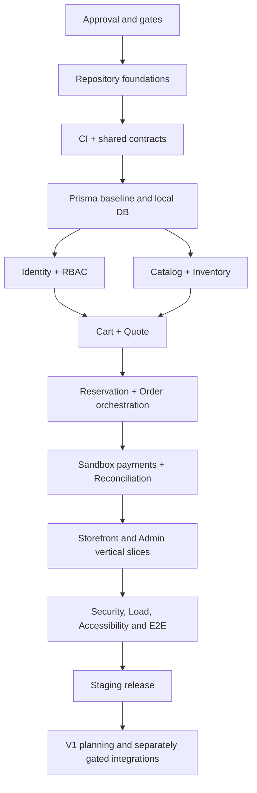

# CommerceHub — adopted implementation plan

2026-10-21 (Africa/Cairo). **CH-01–CH-21 ADOPTED as operative planning baseline.**
Owner explicitly approved adoption, five ownership moves, feature coverage and the
48-milestone schedule after [PR #21](https://github.com/ZeyaadAly/CommerceHub/pull/21)
merged at `8543df03c23423ff58d383dde0de2a5192725dbb`. The adoption decision alone authorized governance synchronization;
separate scoped implementation authority is recorded below. No specialist gate closes.

Default to the [adopted backlog](planning/backlog-consolidation/README.md), [definitions](planning/backlog-consolidation/stories.json),
[full acceptance](planning/backlog-consolidation/backlog.md), [milestone graph](planning/backlog-consolidation/milestones.json) and
[current adoption/status record](planning/backlog-consolidation/adoption.json). Legacy CH-P0-001–CH-P2-059 IDs remain
immutable traceability/history, not a competing top-level work queue.
Every inherited requirement/AC/test and gate remains binding; the original
100 edges are historical while the approved scoped milestone repairs now govern
readiness. [Mapping](planning/backlog-consolidation/mapping.md) and [coverage](planning/backlog-consolidation/coverage.md) retain all assignments.

The material below the LEGACY BASELINE marker is preserved verbatim history and
is not the operative status/dependency model. Stale proposed/pending and 59-story
execution instructions there are superseded by this adopted header.

## Current C acceptance and D preparation — 2026-10-21

C/007 is **DONE for bounded scope**, after all five acceptance clauses, package/consumer/security tests, exact-head CI and owner PR #23 merge at `5c31a735251eeb179ae3a8b174b49f8ac13004d6` were checked. CH-01 remains partial, full 006 BLOCKED. D/008 is **REVIEW** for decision preparation only.

The [single decision matrix](architecture/decisions/decision-matrix.md) provides nine PROPOSED ADR packets, all owner/evidence/blocking requests, acceptance/protection visibility limits and deferred decisions. No specialist gate closes. The owner separately authorized CH-03/API transport only; its implementation is now REVIEW with the bounded API-01 handoff recorded and API-01 still OPEN. CH-03 is IN PROGRESS, never DONE. AUTH/STAFF/DB are unstarted; T has C satisfied but implementation remains UX/quality BLOCKED. No successor starts. Redis spending remains DEFERRED; Docker/WSL not required.

## Operative release plan

| Operative story | Phase | Status      | Delivery                                                |
| --------------- | ----- | ----------- | ------------------------------------------------------- |
| CH-01           | P0    | IN PROGRESS | Foundation, environments, tooling, CI and decision work |
| CH-02           | P0    | NOT STARTED | Reviewed PostgreSQL schema and migration foundations    |
| CH-03           | P0    | IN PROGRESS | Identity, secure sessions and staff governance          |
| CH-04           | P0    | NOT STARTED | Catalog administration, variants, media and public APIs |
| CH-05           | P0    | NOT STARTED | Inventory balances, movements and staff stock tools     |
| CH-06           | P0    | NOT STARTED | Authenticated cart, exact pricing and quotes            |
| CH-07           | P0    | NOT STARTED | Reservation-backed atomic order initiation              |
| CH-08           | P0    | NOT STARTED | Sandbox payments, event authentication and settlement   |
| CH-09           | P0    | NOT STARTED | Durable jobs, audit persistence and observability       |
| CH-10           | P0    | NOT STARTED | Shared accessible design system                         |
| CH-11           | P0    | NOT STARTED | Storefront discovery and customer account delivery      |
| CH-12           | P0    | NOT STARTED | Shopper checkout, payment outcome and order history     |
| CH-13           | P0    | NOT STARTED | Admin overview, fulfillment and operational controls    |
| CH-14           | P0    | NOT STARTED | Performance, accessibility and adversarial MVP proof    |
| CH-15           | P0    | NOT STARTED | Staging and MVP release acceptance                      |
| CH-16           | P1    | NOT STARTED | V1 cancellation, returns and guarded refunds            |
| CH-17           | P1    | NOT STARTED | V1 merchandising, promotions, reviews and wishlists     |
| CH-18           | P1    | NOT STARTED | V1 customer operations, reporting and notifications     |
| CH-19           | P1    | NOT STARTED | Egyptian live payment adapter and reconciliation        |
| CH-20           | P1    | NOT STARTED | V1 UX, regression and release                           |
| CH-21           | P2    | NOT STARTED | Future feasibility and separately scoped research       |

Use milestones rather than whole-parent completion: F is accepted 001–005 evidence;
C contracts and D scoped decisions can be considered independently; T UI primitives
and API transport await C. E_DB and E_QUEUE are distinct readiness boundaries; no
DB/Redis operation follows from this plan. M/DB, early audit A and PERSIST must precede
privileged/order consumers as defined in the approved schedule.

Milestone fields, dependencies and gate notes remain exactly those approved in
[the schedule](planning/backlog-consolidation/schedule.md); do not infer a simplified
parent DAG. Baseline phases remain 48 P0/8 P1/3 P2 original items, organized as
15 P0/5 P1/1 P2 parents. Research is not implementation.

One focused plan per authorized milestone, coherent vertical slices and one or more
reviewable PRs replace separate routine documentation/config/verification stories.
Run relevant tests continuously; exact-head CI and human/specialist review precede
authorized merge. Record acceptance/evidence and continue only to another explicitly
authorized milestone. Otherwise recommend next work and stop. Separate credential,
DB/migration, resource, spending, deployment and financial approvals still apply.

## Historical C implementation checkpoint — 2026-10-21

This REVIEW checkpoint is superseded by the current acceptance above; its preparation evidence is retained.

The owner separately authorized Milestone C only after PR #22 merged at
`09fc6aa04d8df8a20cc5eb6e3752ae25d5e42bd7`. Bounded shared transport/schema/client
implementation is **REVIEW**, not DONE; human acceptance and merge are pending.
[Milestone C evidence](verification/CH-01-C.md) maps all five inherited CH-P0-007 clauses, public exports,
negative tests and unresolved API policies. Canonical schemas own inferred types;
no domain policy or specialist gate closes. CH-01 stays partial, 006 BLOCKED,
D/008 and every later milestone unstarted; Redis/spending DEFERRED.

## CH-03/API transport checkpoint — 2026-10-21

[Technical handoff, inherited acceptance and actual verification](verification/CH-03-API.md) record transport-only REVIEW. PR #24 merge `ffa113804b4c38237576e6fafaf637cb50779f01` was verified before work; its ADR recommendations remain unsigned PROPOSED. Existing F/C acceptance is unchanged. No authentication, staff governance, persistence or business implementation is accepted. API-01 and all specialist gates remain OPEN; full 006 BLOCKED, Redis spending DEFERRED, Docker/WSL not required. Independent CH-10/T design preparation is a possible next separately authorized task; T implementation awaits UX/quality evidence, and no next milestone starts here.
<!-- LEGACY BASELINE: 8543df03c23423ff58d383dde0de2a5192725dbb -->

# CommerceHub — BMAD Implementation Plan

**Document ID:** CH-BMAD-07  
**Filename:** `07-implementation-plan.md`  
**Version:** 1.0 (implementation planning candidate)  
**Date:** 2026-10-18  
**Status:** DRAFT — awaits implementation-plan approval; no application code or migrations executed  
**Upstream approved baselines:** `01-project-brief.md`, `02-prd.md`, `03-ux-specification.md`, `04-architecture.md`, `05-database-design.md`, `06-api-design.md` (API contract approved 2026-10-18).  
**Product:** Single-merchant, Egypt-first, EGP-only P0 physical-products multi-category commerce platform.  
**Owners:** Product/UX, Tech Lead, Backend/Data, Security, Finance, Operations.

> Approval of a design baseline is **not** approval of financial policies, security posture, hosting arrangements, or production operation. Gates FIN-01, FIN-02, INV-01, SEC-01, PAY-01, OPS-01, LEG-01 and PAY-LIVE remain explicitly open until separately reviewed. No engineering work is claimed done. This file plans implementation but does not authorize database migrations, deployment, or production payment processing.

## 1. Outcome, execution rules, definitions

Target three separable deliverables: Next.js storefront, Next.js admin dashboard, one NestJS REST API backed by one PostgreSQL database; a restricted BullMQ worker and Redis support reliable background operations. Both UIs talk through the API only. Favor a **modular monolith** with strict business-logic ownership by NestJS, typed shared contracts, protected internal modules, and robust transaction boundaries.

**Definitions:** P0/MVP = essential storefront shopping plus sandbox payment, basic order fulfillment, stock management and staff RBAC; P1/V1 = returns/refunds, promotions, reviews, wishlists, extended customer operations/analytics, reviewed live gateway; P2/future = recommendations, loyalty, warehouse/multivendor/international expansion. `READY` = dependencies approved, gates satisfied, explicit test plan; `DONE` = implemented, locally tested, reviewed, merged, documentation updated; `DEPLOYED` = verified in named environment with release evidence. No task is called DONE merely because Codex reports success.

**Non-negotiables:** no floating-point money; never trust browser money/stock/payments; no direct DB access from Next.js; EGP amounts serialized as decimal strings; HTTP-only revocable sessions; granular backend RBAC; no card data; idempotent checkout/payment effects; locked reservation state transitions; audit trails; no silent changes to approved API; P1 feature seams do not automatically become MVP tables/routes. Prefer feature-flagged small vertical slices, avoid premature distributed services.

## 2. Release map and exclusions

| Milestone | Content / evidence | Exit gate |
|---|---|---|
| M0 — Decisions & foundations | Gate policies for initial implementation, repo tooling, CI, workspace architecture, ADR trace | Gate owner approval, checks green |
| M1 — API core and identity | Prisma foundation, sessions, accounts, RBAC, catalog read/write | Auth and RBAC integration tests |
| M2 — Shopping + safe stock | Cart, quotes, inventory ledger/holds, checkout/order orchestration | Concurrent reservation tests, financial golden cases |
| M3 — Sandbox commerce | Mock adapter, idempotency, signed sandbox events, order states and admin fulfillment | End-to-end purchase, replay and fault tests |
| M4 — UI and MVP hardening | Storefront/admin real APIs, page-aware fetch, accessibility, diagnostics, CI/CD, staging | Complete MVP acceptance evidence |
| M5 — V1 extensions | Returns/refunds, coupons, reviews, wishlists, richer analytics; live payments separately gated | Refund invariants and live gateway readiness |
| M6 — P2 research | Recommendation, loyalty, multi-warehouse, marketplace, multi-currency | New PRDs/ADRs; no speculative implementation |

**Out of P0:** guest checkout and merge, customer self-service cancellations, refunds and returns, coupons, wishlists, public reviews, live gateway, large exports, AI discovery, multi-warehouse, marketplace and multi-currency. Basic admin payment visibility and order fulfillment are in P0. Product pictures and SEO are included; advanced marketing is not.

## 3. Dependency graph and critical path



Tasks can be parallelized only when APIs/schemas and ownership are frozen, e.g. UI foundations can proceed on checked-in mock contracts while API is built. Never use frontend mocks as evidence of API correctness. Every database migration requires reviewed SQL, rollback/forward plan and backup/test restore appropriate to environment.

## 4. Review gates and authoritative sign-offs

| Gate | Decision owner | Required artifact / acceptance | Blocking scope |
|---|---|---|---|
| FIN-01 | Product + Finance | EGP precision, round-at-line/aggregate policy, tax incl/excl, shipping quote, discount allocation, representative golden invoices | Quote/checkout/persistence of settled money |
| INV-01 | Backend + Product | TTL (15m only candidate), expiry vs late success, reservation quotas, replacement/reversal, retry semantics, lock ordering | Checkout holds and payment finalization |
| SEC-01 | Security + Backend | Origin topology/BFF decision, SameSite/Secure cookie config, CSRF, rate limits, MFA/staff policies, delegation safety, secret rotation | Session deployment and privileged writes |
| PAY-01 | Backend + Finance | Sandbox authorization/capture interpretation, idempotency retention/shape, event signing fixture, reconciliation exception actions | Payment side effects |
| OPS-01 | Operations | Postgres pool connection strategy, worker/Redis durability, storage safety, backups + restore drill, logs/alerts, region/data location, RPO/RTO targets | External infra/staging/prod data |
| LEG-01 | Product + Legal | Privacy notice, retention/deletion rules, Egypt tax/regulatory/shipping claims, email/privacy consent | Launch and retention enforcement |
| FIN-02 | Finance + Product | Refund apportionment, captured ceiling, partial tax/shipping treatment and return eligibility | P1 refunds |
| PAY-LIVE | Payments + Legal/Security | Egypt-supported provider commercial + API verification, signed webhook spec, sandbox certification, disputes/reconciliation, secret custody | P1 real funds |

**Gate workflow:** open review issue with options, recommendation, risks and test examples; owner records decision in ADR/change log; update 01–06 and requirements trace; create/adjust only then tasks dependent on decision. If owner undecided, proceed with unrelated tasks, or contracts/mocks that explicitly exclude blocked side effects. Do not silently choose a default in code.

## 5. Engineering environment and monorepo layout

```text
commercehub/
├── AGENTS.md                 # repository-wide agent guardrails
├── .github/                 # CI, issue and PR templates, CODEOWNERS
├── apps/
│   ├── storefront/          # Next.js App Router — customer UI
│   ├── admin/               # Next.js App Router — staff UI
│   └── api/                 # NestJS API and separately runnable worker entry
├── packages/
│   ├── ui/                  # design tokens and UI primitives (no DB secrets)
│   ├── types/               # public TS-only types
│   ├── validation/          # Zod external schema contracts
│   └── api-client/          # typed requests; credential-safe boundaries
├── docs/                    # approved BMAD files, ADRs, runbooks, QA proofs
├── infrastructure/          # documented hosting, Docker, env templates
├── pnpm-workspace.yaml
├── package.json
└── pnpm-lock.yaml
```

Package manager pnpm; strict TS, consistent eslint/formatter, test scripts, reproducible lockfile and pinned toolchain after verified support check. Separate process for BullMQ workers; do not run durable jobs in serverless frontend handlers. API issues transaction-level authorization and financial outcomes. Admin/storefront may use separate origins **only after SEC-01 cookie proof**.

## 6. Standards, branch policy, and Codex workflow

1. Create GitHub repository, protect `main`, require PR with task ID, reviewers, checks and no force-push. Never embed passwords/DSNs in prompts, code, screenshots or PR comments.
2. A task branch uses `feat/CH-P0-<id>-short-name` (or `fix/`, `docs/`, `chore/`); one reviewable concern per PR; open issue with requirements linkage and dependencies.
3. Codex receives full task prompt with exact scope, doc references, permitted files, prohibited changes, commands, acceptance tests and required final report. It must inspect repository state, not fabricate paths or results.
4. On completion inspect `git diff`, migrations, API changes, security edge cases and actual test output. Red CI or incomplete criteria means task remains OPEN. Push/merge only after a human-approved PR gate; no direct production schema changes.
5. Maintain `docs/architecture/decisions/ADR-###.md`, changelog of approved requirements, test evidence (`docs/verification/<task-id>.md`) and compatibility notes if contracts change. The canonical ADR path was approved by the CommerceHub project owner on 2026-10-18; no other architecture or gate decision is changed by this directory alignment.
6. Codex can use installed skills only after confirming local discoverability and understanding SKILL.md. Do not assume ChatGPT-only plugins are available in Codex.

**PR required fields:** task/requirements IDs; summary and affected modules; new or changed database objects; public API contract diff; screenshots for UI changes; threat/financial impact; tests and results; environment notes; feature flag/rollback; reviewer sign-off. Release candidates must include dependency/security scanning and actual end-to-end logs.

## 7. Repository AGENTS.md strategy

Create root `AGENTS.md` with project identity, approved BMAD docs, repo architecture, lint/test commands (update after scripts exist), auth/payment/inventory invariants, file ownership, response/report format, no secrets, no arbitrary schema changes, no deploys without approval. Each application gets local additions: `apps/storefront/AGENTS.md` (SEO/a11y/UI, active-route fetch), `apps/admin/AGENTS.md` (compact tables, RBAC UX, role-appropriate access), `apps/api/AGENTS.md` (NestJS modules, transactions, audit, permissions, OpenAPI), and optional `packages/validation/AGENTS.md` (contract compatibility). Nested directives extend root, never weaken them. Do not duplicate massive docs inside agent instructions: link to docs and list critical rules. Require Codex to acknowledge any conflicting instructions and stop relevant changes.

**Root template (to create during CH-P0-002, not here):**

```md
# CommerceHub Engineering Rules
- Read docs/01-project-brief.md through docs/07-implementation-plan.md and relevant ADRs before edits.
- Backend owns authorization, EGP prices, stock, order, payment, refund state and audit.
- Never use JS floats for currency; no client-trusted totals or payment-success flags.
- No raw card data or credentials; no DB access from storefront/admin.
- DB migrations, production infra, live payments and gate-dependent code need approval.
- Keep tasks small; update tests/docs with each interface change.
- Before claiming completion, report exact verification commands and outcomes.
```

## 8. Skills.sh discovery, verification and adoption

Verified against public skills.sh listings and published CLI docs on 2026-10-18; a listing **does not** prove local installation or that repository content is safe. Prefer first-party original sources, manually inspect `SKILL.md` and referenced scripts before installing, pin reviewed versions/commits when possible and record approval. CLI syntax `npx skills add <repo> --skill <name>` is documented at https://www.skills.sh/docs/cli. For Codex targeting, use `-a codex` only after confirming the current CLI option in `npx skills add --help`.

| Skill | Verified listing / owner | Intended tasks | Suggested command (not executed) |
|---|---|---|---|
| React/Next.js performance | https://www.skills.sh/vercel-labs/agent-skills/vercel-react-best-practices | storefront/admin routing, queries, bundle and waterfall audits | `npx skills add vercel-labs/agent-skills --skill vercel-react-best-practices` |
| Web design guidelines | https://www.skills.sh/vercel-labs/agent-skills/web-design-guidelines | accessible UI and responsive QA | `npx skills add vercel-labs/agent-skills --skill web-design-guidelines` |
| Frontend design | https://www.skills.sh/anthropics/skills/frontend-design | coherent brand and visual polish | `npx skills add anthropics/skills --skill frontend-design` |
| Supabase PostgreSQL best practices | https://www.skills.sh/supabase/agent-skills/supabase-postgres-best-practices | constraints, pooling, concurrency, indexes | `npx skills add supabase/agent-skills --skill supabase-postgres-best-practices` |

**Verification gap:** No specific first-party NestJS, Prisma, Node security, or test automation skill was source-verified for this plan. Treat these as required **competencies** covered by official documentation, coding standards and tests, not as installed skills. Before adopting one, record owner, immutable source, current skill instructions, security review, exact install command, Codex compatibility and version/commit. Avoid copycat mirrors and blindly executing installers. Skills never override project ADRs, threat model, or authoritative framework docs.

## 9. Quality gates and testing architecture

**Checks per PR:** formatting; lint; strict typecheck; unit tests affected packages; API contract spec diff; migration/static schema lint; dependency/license/secrets audit; build of affected apps. Use Jest/Vitest, Supertest integration, Playwright cross-app E2E, React Testing Library, accessibility automation plus manual keyboard and screen-reader audit. Mock external sandbox events using signed test fixtures; test real DB locks with a disposable PostgreSQL database rather than memory mocks.

**Required P0 evidence:** negative permission matrix; CSRF/origin checks; password/session revocation; inventory race with >available simultaneous buyers; duplicate `Idempotency-Key`, webhook replay/out-of-order/delayed success; rollback on mid-checkout crash; money rounding golden fixtures FIN-01; rate-limit tests; no admin data exposure; order history unchanged after catalog edits; accessible focus/modal/error patterns; no layout overflow at 360/768/1440; no dashboard requests for inactive routes; startup/health, queue downtime and restore drill.

**Proposed SLOs for review (not contractual):** staging p95 API under 400ms for bounded simple read endpoints at agreed load; inventory purchase invariant zero oversells across concurrency fixture; WCAG 2.2 AA target; no high/critical unaccepted vulnerabilities; zero persisted secrets; full critical purchase and staff workflow passes. Tune with measured baseline, don't claim until checked.

## 10. CI/CD, environments and operations

> **2026-10-19 local-development amendment:** [CH-P0-006 Docker-free decision](implementation/CH-P0-006-container-free-decision.md) supersedes mandatory local Docker/WSL/Compose interpretations here and in the E0/006 row. Node-based local development is required; optional Docker and CI service containers remain permissible. Historical wording below is retained. PostgreSQL/Redis isolation, secret scan, clean bootstrap, dependency 003 and OPS-01 for shared infrastructure remain. Resource choices are undecided; implementation is not authorized.

- Environments: developer local (Docker Postgres/Redis or reviewed managed sandbox), isolated CI ephemeral Postgres, staging on dedicated non-production DB, production after gates and restore proof. No shared production credential in preview builds.
- GitHub Actions: on PR install via frozen lockfile -> formatting/lint/typecheck -> unit/contract -> DB integration -> build -> Playwright smoke when applicable -> dependency and secret checks. PR previews for frontends are non-production only with safe API mocks/staging permissions.
- Main merge: produce signed/provenance-tagged build artifact where supported; deploy staging API/worker and frontends independently with health checks; apply migrations through reviewed job with safe forward/backout strategy; run smoke, then manual promotion to prod when OPS-01/SEC-01/FIN-01 satisfied.
- Disaster readiness: separate DB credentials and least privilege; encrypted backups and tested restore (RPO/RTO gated OPS-01), structured redacted logs, trace/request IDs, payment reconciliation alerts, inventory mismatch alerts, BullMQ DLQ/retry policy, runbooks for provider outage and migration failure.
- Rollback: app rollback only if backward-compatible schema; breaking schema uses expand/migrate/contract multi-release approach; financial mutation rollback is compensating transaction, not database history delete.

## 11. Database migration review checkpoints

| Checkpoint | Scope | Review/acceptance |
|---|---|---|
| DB-0 | Finalize FIN-01, SEC-01, DB naming, Prisma mapping, invariants | approved ADR and model review |
| DB-1 | Identity, roles, sessions, catalog foundation | key/unique constraints; migration CI in empty DB |
| DB-2 | Inventory balances, reservations, stock movements | transactional concurrency proof; no negative available |
| DB-3 | Orders, immutable lines/address snapshots, idempotency | historical consistency and idempotent create tests |
| DB-4 | Payment attempts, verified events, outbox, audit | duplicate and out-of-order reconciliation fixtures |
| DB-5 | Staging migration exercise, pools, backup/restore | forward migration from prior version, verified restoration |
| DB-6 | P1 returns/refunds, marketing, review tables | FIN-02 and PAY-LIVE approvals before financial mutation |

Never use `prisma db push` as production migration policy. Inspect generated SQL for indexes, partial/conditional constraints and locking effects that Prisma cannot fully express; include hand-reviewed SQL migrations as necessary. Migration rollback plan must respect append-only financial/audit history.

## 12. Work breakdown structure (WBS) — executable task registry

Each line is a **small deliverable**, with stable task ID, priority, concrete dependency, gate, expected acceptance and test. Detailed behavior and data fields inherit approved PRD (`CH-*`), API sections, UX pages and DB tables; implementers must attach the precise requirement IDs to the issue before coding. `CH-P0-001` is **planning approved only** once the implementation plan is accepted; tasks themselves have not run. `Gate` values mean implementation must not cross the gate until sign-off; a policy or tests-only task may be prepared without production side effects. Priority P0/P1/P2 refers to release, not vulnerability severity.

Task estimates are intentionally omitted: use actual repo evidence and team velocity to size issues, splitting tasks further when they exceed a focused PR. A hard dependency is satisfied only by a reviewed merged predecessor, not a mock declaration.

### E0 — Foundation and governance (P0)

| Task / title | Dependencies | Gate | Acceptance criteria | Verification |
|---|---|---|---|---|
| **CH-P0-001** — Freeze requirement matrix and gate owners | none | none | Map PRD ID to release and owner; record unresolved questions | Document cross-reference review |
| **CH-P0-002** — Create repository and AGENTS guidance | 001 | none | Monorepo tree, root/nested AGENTS and PR templates reviewed | File/layout and instructions audit |
| **CH-P0-003** — Initialize pnpm workspace and strict TS | 002 | none | Reproducible workspace, strict compiler, no implementation modules | Install/build/typecheck smoke |
| **CH-P0-004** — Establish formatting, lint and hooks | 003 | none | One shared lint/format policy, scripts work for each workspace | Lint-format negative fixture |
| **CH-P0-005** — Setup CI pipeline and protected PR flow | 003 | none | CI for lint/typecheck/test/build; branch rules documented | Dry-run failed test blocks merge |
| **CH-P0-006** — Document env/secret boundary and local Docker | 003 | OPS-01 for shared infra only | No secrets in git; dev DB and Redis isolated | Secret scan and clean bootstrap |
| **CH-P0-007** — Create shared validation and API client scaffolds | 003 | none | Zod schemas/types and API client package compile independently | Type and version compatibility tests |
| **CH-P0-008** — Record initial ADR decisions and gate tracker | 001 | none | Each unresolved gate has owner, evidence, blocking ID | Gate audit |

### E1 — Core API, identity and catalog (P0)

| Task / title | Dependencies | Gate | Acceptance criteria | Verification |
|---|---|---|---|---|
| **CH-P0-009** — Design Prisma identity/RBAC schema | 006,008 | SEC-01 on session semantics | Constraints match DB doc; safe relation deletion | Migration review and schema test |
| **CH-P0-010** — Apply identity/catalog baseline to disposable DB | 009 | DB-0 | Reviewed SQL, rollback/forward notes, CI apply clean | Fresh/migrated DB integration |
| **CH-P0-011** — NestJS app skeleton and API policy middleware | 003,007 | none | Module boundaries, validation, errors, OpenAPI, health | Supertest contracts |
| **CH-P0-012** — Password credentials + verification flows | 010,011 | SEC-01 | Argon2id hashes, one-time tokens, enumeration safe | Unit + negative integration |
| **CH-P0-013** — Opaque cookie sessions and CSRF defenses | 012 | SEC-01 | Rotate/revoke/expire correctly; secure origin policy | Session and CSRF integration |
| **CH-P0-014** — Staff bootstrap and granular RBAC guards | 013 | SEC-01 | Least privilege and last Super Admin protections | Full deny/allow matrix |
| **CH-P0-015** — Catalog CRUD, variants, publication | 010,011,014 | none | Slugs/SKUs unique; only published visible publicly | CRUD + visibility tests |
| **CH-P0-016** — Media upload policy and image linking | 015 | OPS-01 | Validated type/size and authorized object storage | Invalid upload/security tests |
| **CH-P0-017** — Public catalog browse/search/filter API | 015 | none | Cursor stable, whitelist filtering, no draft leak | Contract + pagination tests |

### E2 — Inventory, cart and checkout (P0)

| Task / title | Dependencies | Gate | Acceptance criteria | Verification |
|---|---|---|---|---|
| **CH-P0-018** — Inventory ledger and balance migration | 010,008 | INV-01 | CHECK protections and immutable stock movements | Constraint and transaction tests |
| **CH-P0-019** — Inventory adjustment admin API | 018,014 | INV-01 | Permissioned reason-coded movements, no stock below holds | Concurrency, RBAC and audit |
| **CH-P0-020** — Authenticated cart endpoints | 013,017 | none | Cart validates variant and quantities; no price trust | CRUD and ownership tests |
| **CH-P0-021** — Financial quote rules and fixtures | 020,008 | FIN-01 | Exact EGP totals and approved tax/shipping model | Golden rounding tests |
| **CH-P0-022** — Quote read/create/expiry contracts | 021 | FIN-01 | Server recomputes prices, rejects stale tampered inputs | Quote replay tests |
| **CH-P0-023** — Reservation state machine and DB locks | 018,022 | INV-01 | Atomic ACTIVE to terminal, expiry safety via DB clock | Parallel buyer stress test |
| **CH-P0-024** — Order and snapshot migration | 010,022 | FIN-01 | Immutability and historical snapshots, FK restrictions | Snapshot mutation regression |
| **CH-P0-025** — Atomic quote acceptance -> order/hold | 023,024,013 | FIN-01,INV-01 | One order per idempotent command, no oversell | Crash rollback + 100 concurrent calls |

### E3 — Sandbox payments and operations (P0)

| Task / title | Dependencies | Gate | Acceptance criteria | Verification |
|---|---|---|---|---|
| **CH-P0-026** — Payment intent and attempt schema | 025 | PAY-01 | Unique effects, provider refs and idempotency keys | Migration constraints and replay |
| **CH-P0-027** — Sandbox provider adapter | 026 | PAY-01 | Deterministic mock outcomes, no live network or card data | Adapter unit suite |
| **CH-P0-028** — Sandbox signed webhook receiver | 027 | PAY-01 | Raw-body signature validation; unique event dedupe | Bad signature, replay tests |
| **CH-P0-029** — Settlement and order transition coordinator | 028,023 | PAY-01,INV-01 | Out-of-order handling, no success on redirect | Race and late-success tests |
| **CH-P0-030** — Outbox and BullMQ retry processing | 029 | OPS-01 | At-least-once jobs idempotent; backoff and DLQ | Queue outage and recovery |
| **CH-P0-031** — Customer order history/detail | 025,029 | none | Only owner sees snapshots and statuses | Cross-user 404 regression |
| **CH-P0-032** — Admin fulfillment and payment oversight | 014,029 | none | Permissioned valid transitions with audit | State transition/role tests |
| **CH-P0-033** — Audit logs and anomaly observability | 014,030 | OPS-01 | Redaction, trace IDs and admin audit visibility | Log leak/fail-closed tests |

### E4 — Storefront, admin and MVP release (P0)

| Task / title | Dependencies | Gate | Acceptance criteria | Verification |
|---|---|---|---|---|
| **CH-P0-034** — Shared tokens and UI primitives | 007 | none | Responsive accessible forms/buttons/tables, no overflow | Story/unit/a11y review |
| **CH-P0-035** — Storefront layout and catalog UI | 017,034 | none | SEO metadata and working list/filter URLs | Playwright 360/768/1440 |
| **CH-P0-036** — Product detail and add-to-cart UI | 035,020 | none | Correct variant availability, pending/error states | RTL + E2E variant flow |
| **CH-P0-037** — Customer account and address UI | 013,034 | SEC-01 | Secure form flows, normalized errors | Login/password e2e |
| **CH-P0-038** — Checkout and sandbox payment UX | 025,029,036 | FIN-01,INV-01,PAY-01 | Displays server quote; uncertain outcomes never shown paid | Purchase and timeout E2E |
| **CH-P0-039** — Customer order pages | 031,038 | none | Accurate history and tracking, loading/empty/error | Owner isolation e2e |
| **CH-P0-040** — Admin shell and overview | 014,034 | none | Role-aware shell and lightweight KPIs only | Network request assertion |
| **CH-P0-041** — Admin product/catalog UI | 015,040 | none | Compact forms, variants, images and accessible CRUD | Form validation/overflow e2e |
| **CH-P0-042** — Admin inventory UI | 019,040 | none | Paginated stock/movement, read-only by permission | Role and table e2e |
| **CH-P0-043** — Admin order/fulfillment UI | 032,040 | none | Allowed actions, filters, error and conflict handling | Status transitions e2e |
| **CH-P0-044** — Admin staff/RBAC and audit UI | 014,033,040 | SEC-01 | Cannot expose unauthorized grant actions; API blocks | Privilege escalation e2e |
| **CH-P0-045** — Optimize queries/cache and active-route fetching | 035,040,044 | none | Inactive modules never fetch; no duplicate requests | HAR/network budget regression |
| **CH-P0-046** — MVP end-to-end and accessibility suite | 038,039,043,044,045 | none | Happy and failure purchase, desktop/mobile, WCAG review | Full Playwright + manual keyboard |
| **CH-P0-047** — Security/load/fault-injection readiness | 046,033 | FIN-01,INV-01,SEC-01,PAY-01,OPS-01 | No critical failures or unresolved high-severity findings | Concurrency, pentest checklist, restore |
| **CH-P0-048** — Staging deployment, documentation and go/no-go | 047,005 | OPS-01,LEG-01 | Smoke verified URLs and observed runbooks; no live payments | CI/CD logs and product sign-off |

### E5 — V1 business capabilities (P1)

| Task / title | Dependencies | Gate | Acceptance criteria | Verification |
|---|---|---|---|---|
| **CH-P1-049** — V1 requirements/gates review | 048 | FIN-02,PAY-LIVE for gated subset | P1 scope/ADR and provider shortlist approved | Contract review |
| **CH-P1-050** — Return request and review workflow | 049 | LEG-01 | Eligibility and return states documented and tested | Return state tests |
| **CH-P1-051** — Refund calculation and guarded DB effects | 050 | FIN-02,PAY-LIVE | Total pending+done <= captured with exact allocations | Partial/duplicate/concurrent refund tests |
| **CH-P1-052** — Promo/coupon rules and redemption ledger | 049 | FIN-01 revision | Exclusive conditions, ceilings and replay safety | Coupon stack/expiry tests |
| **CH-P1-053** — Reviews and wishlists | 049 | none | Authorized reviews; owner-only wishlists | Moderation and ownership tests |
| **CH-P1-054** — Analytics and customers operations | 049 | SEC-01 | Permission-scoped bounded KPIs and PII-safe exports | Query/perms/performance tests |
| **CH-P1-055** — Live Egypt payment adapter and reconciliation | 049,051 | PAY-LIVE,OPS-01,LEG-01 | Provider Egypt support and certification verified | Signed sandbox certification run |
| **CH-P1-056** — V1 UX, regression and release | 051,052,053,054,055 | all scoped V1 gates | Refund/returns UX tested; controlled launch | End-to-end regression |

### E6 — P2 research and feasibility (P2)

| Task / title | Dependencies | Gate | Acceptance criteria | Verification |
|---|---|---|---|---|
| **CH-P2-057** — Recommendation/loyalty feasibility | 048 | new P2 PRD | Privacy-aware feasibility and acceptance scope | ADR/research review |
| **CH-P2-058** — Multi-warehouse feasibility | 048 | new INV architecture | Stock allocation and race model proposal | Concurrency threat review |
| **CH-P2-059** — Marketplace/multi-currency feasibility | 048 | new financial/legal ADR | Tenant isolation, settlement and tax model study | Threat and legal review |

## 13. Requirement traceability and feature slicing

The authoritative ID-level mapping is the PRD and `06-api-design.md`; implementation issue templates **must** record `PRD refs: CH-...`, `API refs: endpoint + API-### tests`, `DB refs: tables/invariants`, and `UX refs: screen + UX tests`. Start with these slices:

| Slice | Data/authorization | Backend contracts | UX surfaces | Demonstration |
|---|---|---|---|---|
| Identity | users/sessions/staff roles | `/auth`, `/me`, `/admin/staff` | account forms, staff controls | last Super Admin cannot be removed |
| Catalog | product/variant/category/media | `/catalog`, `/admin/products` | listings, product detail, admin catalog | unpublished stock is invisible |
| Cart/quote | cart, quote versions, EGP snapshots | `/cart`, `/checkout/quotes` | cart, checkout totals | tampered price ignored |
| Order/hold | reservation, ledger, orders | `/checkout`, `/orders`, `/admin/orders` | confirmation, fulfillment | 2 buyers/1 unit -> 1 valid purchase |
| Payment | intents/attempts/events/outbox | sandbox attempt, signed sandbox webhook | payment status and admin visibility | repeated signed event no duplicate state |

## 14. Explicit task definition of done

A task closes only if: (1) upstream gates and dependencies documented; (2) code stays in allowed modules; (3) OpenAPI/DTO and migrations reviewed where changed; (4) tests include positive + negative + edge case and ran successfully; (5) lint/typecheck/build succeed; (6) security and accessibility reviewed when touched; (7) no secret or PII logging; (8) PR description has task ID, run commands with captured result, screenshots when UI; (9) docs/ADRs updated; (10) human reviewer approves. A blocked requirement is shown as `BLOCKED`, not silently accepted. CI environment failures do not count as passed tests. Do not mark dependent stories DONE before DB semantics are proven.

## 15. Codex prompt library — initial tasks

Prompts below are ready to paste once the implementation plan is approved. They are ordered and expressly forbid coding tasks ahead of their gates. The first prompt performs a **repository and gate audit only**, the second creates developer instruction documents, and the third is foundational repo setup **after** approvals. Ensure Codex has access to all six baseline docs (and this plan) in `docs/`; if not, copy them into the repository before running a prompt. Never paste private credentials.

### Prompt A — CH-P0-001: Baseline and gate audit (documentation only)

```text
You are acting as CommerceHub's senior technical lead. Task CH-P0-001.
Objective: audit the approved BMAD design docs and prepare an implementation-ready requirements/gate registry WITHOUT coding.
Read: docs/01-project-brief.md through docs/07-implementation-plan.md. Treat 01–06 as approved baseline; 07 as pending approval until the owner explicitly confirms.
Scope: (1) map MVP features to PRD requirement IDs, API sections, database modules, UX screens, and CH-P0 task IDs; (2) create docs/implementation/requirements-traceability.md and docs/implementation/gate-register.md (if this work is authorized); (3) enumerate FIN-01/02, INV-01, SEC-01, PAY-01, OPS-01, LEG-01, PAY-LIVE, their owners, decision options, evidence and blocked tasks; (4) identify contradictions without rewriting approved baselines unilaterally.
Constraints: no code generation, package install, migrations, database connections, deployments, payment integrations, or changed financial policy; no fabricated approvals.
Tests: verify markdown links, unique IDs, no orphan tasks, all P0 API families included, and no gate-dependent task accidentally marked ready.
Acceptance: concise traceability table and review-ready gates, backed by doc section references.
Final report: exact files touched; discrepancies and suggested ADRs; commands/checks actually run and their output; blockers; diff summary. If repo/docs absent, report missing prerequisites rather than inventing them.
```

### Prompt B — CH-P0-002: Repo agent policies and contribution controls

```text
Task CH-P0-002. Dependency: CH-P0-001 reviewed and approved. Goal: create repository-level Codex engineering guidance and PR metadata, not business functionality.
Inspect the current repo, read all approved BMAD docs and gate register, and preserve pre-existing files. Create/update root AGENTS.md and narrowly scoped apps/storefront/AGENTS.md, apps/admin/AGENTS.md, apps/api/AGENTS.md, packages/validation/AGENTS.md if those directories exist or are explicitly approved for docs-only placeholders. Add .github/PULL_REQUEST_TEMPLATE.md, docs/architecture/decisions/README.md, docs/verification/README.md.
Root rules: strict TS; NestJS owns all money, authz, stock, payment effects; EGP exact decimal strings; no raw card data; no secrets in commits; no DB access from Next.js; don't cross named gates; never declare tests passed without running; feature scope P0 vs P1 vs P2; always show changed files and verification commands. Specialized guidance: storefront accessible SEO/product UI and active route fetch, admin compact tables and permission-aware UX, API audit and transactions, validation backward-compatible contract checks.
Do not install packages, create migrations, change deployed infra or implement endpoints. Do not overwrite established team conventions without documenting the conflict.
Verify all references/paths, no contradictory nested AGENTS rules, AGENTS instructions fit Codex discovery behavior; perform markdown/link lint if existing command exists.
Report exact files/diff, verification output, follow-up decisions and approval needed for next task. Commit only with permission; do not push/merge automatically.
```

### Prompt C — CH-P0-003: Minimal monorepo toolchain scaffold

```text
Task CH-P0-003. Dependencies CH-P0-002 approved/merged, implementation plan approved. Objective: initialize a healthy pnpm TypeScript monorepo without building any commerce features.
Review docs/01–07, AGENTS.md and current repository. Verify current supported Node.js LTS, pnpm, Next.js, NestJS, TypeScript, Prisma compatibility from official release docs before locking versions; document exact versions, rationale, and commands. Avoid blindly using latest tags where incompatible.
Create pnpm-workspace.yaml, package.json scripts and lockfile, shared tsconfig and basic apps/storefront, apps/admin, apps/api and packages/ui, types, validation, api-client workspaces where absent. Provide only minimal bootstraps with a placeholder route/API health in the authorized scope, no database access or authentication implementation. Add .gitignore, .env.example with fake placeholders, no secrets; README local setup. Keep layouts responsive and semantic if any UI is scaffolded. Do not add payment SDK, production DB credentials or live calls.
Acceptance: clean install with frozen lockfile, workspace build and typecheck, independent startup smoke for the three applications, no cross-app import cycles or Next.js->Prisma paths, root scripts documented.
Testing: run package manager install, formatting/lint/typecheck/build and minimal smoke where environment supports it. If tools unavailable, label checks NOT RUN and provide replication steps; never mark DONE.
Report dependency versions, files touched, exact commands/results, build warnings, follow-on tasks. No production deploy/migration. Stop and request decision on conflicting architectural constraints.
```

### Prompt D — CH-P0-005: CI quality checks

```text
Task CH-P0-005; depends on CH-P0-003 and CH-P0-004 merged. Set up GitHub Actions pull-request CI (no prod deployment).
Build a workflow using reproducible Node/pnpm install, caches scoped correctly, format/lint/typecheck/unit/build, with safe dummy config where needed. Add secret-scan/dependency advisory controls and minimal PR merge protection documentation. Never print secrets. Use isolated temporary database services only for integration suites when they exist. Avoid broad GitHub token write scopes and untrusted PR execution of privileged jobs. Include explicit instructions for turning on branch protection manually.
Acceptance: PR checks fail for deliberate type/lint/test violation, succeed for clean branch; workflow never accesses prod secrets. Run local YAML validation and scripts; report which checks were actually executed and which need GitHub verification.
```

### Prompt E — CH-P0-008: Gate ADR pack before financial/security implementation

```text
Task CH-P0-008; depends CH-P0-001. Prepare review-only ADRs for FIN-01, INV-01, SEC-01, PAY-01, OPS-01 and LEG-01. Use docs/04–06 to list contract effects, alternatives, risks, golden acceptance fixtures, owners and decision deadlines. Keep status PROPOSED, not ACCEPTED. Explicitly resolve the mismatch if a document assumes shipping tax or a 15-minute TTL as final. Do not code, migrate, deploy or introduce live payment processing. Deliver a signed-off checklist and gate-to-task matrix; cite exact upstream sections. Report remaining open gates.
```

### Prompt F — CH-P0-011: API skeleton (after toolchain, before domain logic)

```text
Task CH-P0-011, dependencies CH-P0-003 and CH-P0-007. Review current repo/docs and implement an empty NestJS modular skeleton with versioned /api/v1 controllers, global validation/error envelope, OpenAPI generation, request ID, safe structured logging, minimal health endpoint, and testing harness. No auth logic, no business entities or real DB migrations. Keep DTO contract definitions in packages/validation where agreed. Verify error-code shape against 06-api-design.md and do not invent new behavior silently.
Acceptance: strict TS and lint, /health and /api/v1 documented, malformed input deterministic error, no secrets in logs, Supertest contract tests pass. Report modified files and exact tests; request review before continuing to any gated financial module.
```

## 16. Milestone demonstration scenarios

- **M0:** new developer can clone docs and workspace, identify every open gate and run lint/typecheck; no secrets present.
- **M1:** customer can register/login; unauthenticated catalog can be viewed; staff permission grants are correctly enforced in API; admin product publication reflects on storefront.
- **M2:** pricing tamper ignored; an exact EGP quote yields immutable order snapshots; a single remaining unit cannot be oversold by parallel checkouts.
- **M3:** sandbox accepted/declined/pending outcomes show correct order state; duplicate signed webhooks and request retries do not double charge or consume inventory.
- **M4:** end-to-end store purchase and authorized fulfillment complete in staging, with readable compact admin tables, no overflow, correct active-page network behavior, accessible flows and redacted logs; operational sign-offs recorded.
- **M5:** verified V1 return/refund, coupon, reviews and analytics; real payment integration only if independently certified for Egyptian operations.
- **M6:** validated business case and new design approvals; not automatically deployed.

## 17. Known risks, mitigations and escalation

| Risk | Severity | Mitigation and escalation |
|---|---|---|
| Cross-origin HTTP-only session mismatch | Critical | SEC-01 origin proof before auth UI, secure cookie/CSRF test matrix |
| Oversell under parallel requests | Critical | INV-01 state machine, DB locks, real PG stress fixtures |
| Inaccurate taxes/shipping/rounding | Critical | FIN-01 golden examples and finance owner sign-off |
| Provider webhook replay/late success | Critical | PAY-01 signed fixtures, idempotent event ledger and reconciliation operator flow |
| Data loss or stuck workers | High | OPS-01 backups, restore drills, outbox, DLQ and alerts |
| Privilege escalation via staff management | Critical | API RBAC with immutable audit and last-super-admin safety |
| P0 scope creep into V1 refunds/live gateway | High | hard release labels and blocked dependencies |
| Dashboard wasteful requests / layout overflow | Medium | route-owned query keys, network audits, viewport checks |
| Unreviewed third-party skill execution | High | source inspection, pin and review before install |
| Migration backward incompatibility | High | expand/contract and staged trial migrations |

## 18. Completion/approval checklist

- [ ] Product owner explicitly approves this implementation plan and P0 release boundaries.
- [ ] Gate register has owner, current status, artifact and blocked implementation IDs.
- [ ] GitHub repository exists and all approved source docs are versioned under `docs/`.
- [ ] CH-P0-001 traceability audit is complete before coding.
- [ ] AGENTS files and verified skill adoption completed before large Codex changes.
- [ ] Critical FIN/INV/SEC/PAY gates approved before their dependent code.
- [ ] Testing environment can reproduce concurrency and payment replay.
- [ ] Non-production DB and rollback/restore evidence reviewed before staging migration.
- [ ] CI branch protection, zero-secrets policy and reviewer ownership in place.
- [ ] MVP release evidence and manual go/no-go recorded before production deployment.

**The next unfinished BMAD activity after approving this document is M0/CH-P0-001 (documentation audit and gate ownership), not application feature coding.**

## 19. References and evidence

**Approved internal baselines:** `01-project-brief.md` (business and exclusions); `02-prd.md` (feature IDs); `03-ux-specification.md` (UI contract); `04-architecture.md` (ADRs and risk gates); `05-database-design.md` (schema/transactions); `06-api-design.md` (REST/permission and API test contracts). Always prefer these over generic skill opinions until an explicit ADR changes them.

**External skills verified on 2026-10-18:** https://www.skills.sh/docs/cli ; https://www.skills.sh/vercel-labs/agent-skills/vercel-react-best-practices ; https://www.skills.sh/vercel-labs/agent-skills/web-design-guidelines ; https://www.skills.sh/anthropics/skills/frontend-design ; https://www.skills.sh/supabase/agent-skills/supabase-postgres-best-practices . Listings and commands verified; package installation, local tooling availability, test execution and skill safety review **not performed**.

