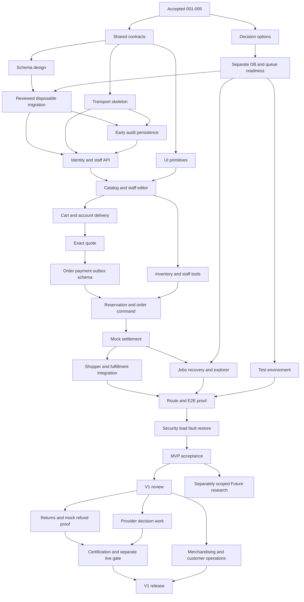

# Proposed dependency repairs and delivery sequence

**PROPOSED.** This is not an authorized execution queue. Original dependencies,
gate strings and historical statuses remain unchanged in the operative backlog.
The 100 declared original edges are individually retained in inventory.json.
The 48 proposed milestones in [milestones.json](milestones.json) are tasks/evidence
boundaries within 21 parents, not 46 new stories or mandatory documents/PRs.

## Why milestone dependencies matter

Do not mechanically collapse old dependency edges into full-parent prerequisites.
That would make CH-01/006 block independent contracts/tokens, make CH-03 wait on
CH-09's late explorer while CH-09 needs staff, and hide the order/payment/outbox
schema cycle. A parent can be incomplete while a reviewed, merged milestone is
usable. Every original acceptance obligation remains due before parent completion.
Never claim the original 006, 033, 040 or 044 DONE from a partial milestone.

F means only accepted 001–005 evidence. C=007 contracts/client; D=008 decision
options; E_DB/E_QUEUE are separately evidenced 006 DB/queue readiness, not whole
006 or a new provider choice. M/DB are design and authorized disposable migration.
A is 033 early audit persistence. T is 034 tokens/primitives. API is 011 transport.
PERSIST coordinates 024/026/030 schema contributions before command consumers.
STAGE_A prepares the test environment; STAGE_B is final release acceptance.
CAT_API is the accepted catalog contract/domain boundary; CAT completes media and
staff editor acceptance. OPS_V1_BASE allows support/session/notification tasks in
parallel with returns; final OPS_V1 reporting joins refund contracts explicitly.
All named gates in the JSON are additional conditions, never automatic successes.

The JSON contains every milestone's owner, prerequisite set, scope and gate note.
It is the detailed proposed dependency graph; the picture below is a readable
projection. The verifier checks references and topological order on the full JSON.

## Explicit scheduling changes requiring approval

| Repair                | Original dependency/ambiguity                                                              | Proposed scoped repair and preserved boundary                                                                                                                                                                                                                                                                                        |
| --------------------- | ------------------------------------------------------------------------------------------ | ------------------------------------------------------------------------------------------------------------------------------------------------------------------------------------------------------------------------------------------------------------------------------------------------------------------------------------ |
| R-01 / BA-17          | 005 declared only 003, prompt also needs 004                                               | Retain 005 historical DONE; future CI maintenance uses actual accepted 004 tooling. No retroactive status/dependency rewrite.                                                                                                                                                                                                        |
| R-02 / BA-05          | 009 identity design → 010 identity/catalog apply                                           | M adds catalog design, default-SKU/price constraints and FIN/SEC decisions before affected SQL. DB-0/DB-01 still precede writes.                                                                                                                                                                                                     |
| R-03 / BA-06          | 023 precedes order FK foundation 024; 025 consumes later 026/030 objects                   | PERSIST puts reviewed 024/026/idempotency/outbox foundations before RESERVE/ORDER. Original 026→025 dependency is split: schema portion moves before command; later adapter/settlement acceptance remains after order prerequisites. PAY/INV/FIN/DB reviews mandatory.                                                               |
| R-04 / BA-06          | 030 waits on 029, but outbox needed in 025                                                 | Only outbox persistence contract/schema contributes early; worker dispatch/retry remains after SETTLE. No queue work or Redis assumed complete.                                                                                                                                                                                      |
| R-05 / BA-07          | 033 depends on 014/030, privileged writes need audit sooner                                | A precedes STAFF_API, stock and fulfillment writes. Explorer/observability retains later STAFF/JOBS prerequisites. Ordinary audit policy is not guessed.                                                                                                                                                                             |
| R-06 / BA-08/14       | 037 UI depends only on 013/034; 022 needs address API                                      | ACCOUNT includes profile/address API/schema/default concurrency/email-change contract before QUOTE. Backend service ownership stays in NestJS.                                                                                                                                                                                       |
| R-07 / BA-09/18       | 036/038 omit complete cart and account chain                                               | CART explicitly owns editable /cart; CHECKOUT waits for STORE, ACCOUNT, QUOTE/ORDER/SETTLE. Guest merge remains BA-02 blocked.                                                                                                                                                                                                       |
| R-08 / BA-18          | 041/042/044 wait for full 040; 044 waits full 033                                          | Split SHELL from late overview aggregation. CAT/INV require shell and own APIs; STAFF_UI uses early A, but remaining 044 audit UI still waits EXPLORER. No UI completion before its actual API contract.                                                                                                                             |
| R-09 / BA-18          | 045 omits route suites; 046 omits 041/042                                                  | PERF waits all catalog/inventory/account/shopper/staff/order/audit route integrations; E2E includes all critical routes.                                                                                                                                                                                                             |
| R-10 / BA-19          | 047 verification needs environment before final 048                                        | STAGE_A is an authorized preparation task within CH-15 before E2E/HARDEN; STAGE_B still waits HARDEN, OPS/LEG and accepted CI. Infrastructure approval is not bypassed.                                                                                                                                                              |
| R-11 / BA-21          | 049 review gates can be read as requiring approval first; 051 PAY-LIVE and 055 depends 051 | V1_REVIEW/provider research can prepare decisions. MOCK_REFUND requires Finance/Payments approval of the staged gate disposition before implementation; real execution remains PAY-LIVE protected. LIVE certification/activation requires refund capability and signed provider decision/proof. No declared gate is silently waived. |
| R-12 / broad grouping | Entire consolidated CH-01 could block everything                                           | C/API/T/design-only work uses F/C/D and scoped readiness only; DB writes need E_DB, jobs need E_QUEUE. No 007 implementation or READY status is granted by this proposal.                                                                                                                                                            |

Every baseline edge not addressed by a staged repair remains inherited at the
original acceptance scope. The inventory stores all 100 individual edges and
exact gates; the repair table names every intentional scheduling exception or
new semantic prerequisite. Parent DoD unions all prerequisites, including later
explorer/media/role/provider/test-environment acceptance. An approved rebaseline
must reconcile the operative 07/08/tracker/AGENTS references in one follow-up change;
this PR performs no such rewrite.

## Critical path and parallel lanes

This is a **gate-constrained logical critical chain**, not a duration-based CPM:
no estimates, staffed capacity, provider lead times or approved SLA are available.

The MVP constraint chain is C/D → reviewed M and E_DB → DB → A/AUTH/STAFF_API →
CAT → CART/ACCOUNT/INV → QUOTE → PERSIST → RESERVE/ORDER → MOCK/SETTLE →
JOBS plus shopper/admin integration → PERF/E2E with STAGE_A → HARDEN → STAGE_B.
FIN/SEC/INV/PAY decisions and OPS/LEG environment/release approvals can dominate
elapsed time; queue readiness may become the critical blocker before jobs/recovery.
No claim is made that this ordering is the mathematically longest path.

| Lane                  | Safe parallel scope after relevant authorization                                                      | Integration boundary                                                                                                                 |
| --------------------- | ----------------------------------------------------------------------------------------------------- | ------------------------------------------------------------------------------------------------------------------------------------ |
| Foundation/contracts  | C wire/client and D scoped decision options after F; T and API after C                                | No whole-CH-01 prerequisite; no business side effects or all-gates approval invented                                                 |
| Frontend/UX           | Tokens, shell/layout and contract fixtures while backend is implemented                               | Reviewed API/UX schema, public types, no DB credentials; mocks cannot complete persisted acceptance                                  |
| Backend/data          | Schema/constraint review and early audit; account API alongside catalog/stock after identity          | One owner coordinates migrations/transactions; no concurrent conflicting schema edits                                                |
| Catalog/account/stock | Domain work can split into API/schema/editor and integration PRs                                      | Release only accepted contract versions; inventory does not become price authority                                                   |
| Purchase integration  | Shopper outcome/history and admin fulfillment after trusted settlement contracts                      | Share published status mapping, keep ownership and side-effect policies in API                                                       |
| Operations/QA         | Approved test-environment planning/preparation and fixture design before full E2E                     | No resource provisioning or deployment until separately authorized; real restore/fault proof later                                   |
| V1                    | Returns/refund proof, merchandising and non-refund support/session/notification tasks after V1_REVIEW | Refund-dependent reporting joins approved refund contracts; provider decision work can prepare concurrently, real funds remain gated |
| Future                | Separately scoped research after original MVP exit predecessor                                        | Not a blocker on MVP/V1; no speculative feature implementation                                                                       |

No parallel agent/team work is started by this proposal. Parallel implementation
is an ownership/contract strategy for future explicitly authorized work. Bound
PRs by a coherent behavior and transaction owner (for example catalog API+editor
or one signed migration plus compatibility seam); a large parent is not a mandate
for a giant PR. Review every contract/schema change before its consumers.
